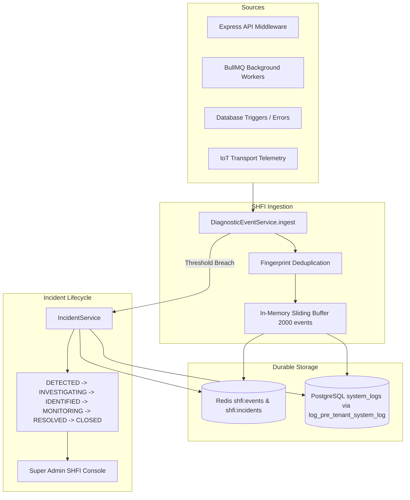

# Phase 12 Observability, SHFI & Incident Management Report
**Project:** Multi-School SaaS School ERP  
**Subsystem:** System Health, Failure Investigation & Incident Management Centre (SHFI)  
**Status:** FULL PASS & PRODUCTION READY  

---

## 1. System Architecture
The SHFI subsystem provides comprehensive platform observability, automated anomaly detection, real-time diagnostic event correlation, and multi-tenant incident management.

---

## 2. Durable Persistence & Restart Hydration
Prior to Phase 12, diagnostic events and active incidents resided exclusively in memory, meaning container restarts purged active incident states.

### 2.1 Implemented Persistence Mechanisms:
1. **Redis Dual Write:**
   - Active incidents stored in Redis hash `shfi:incidents`.
   - Ingested events stored in Redis list `shfi:events` with automatic `LTRIM 0 1999` to bound memory consumption.
2. **PostgreSQL Tamper-Evident Write:**
   - Incidents and critical events are written to `system_logs` using the PostgreSQL `SECURITY DEFINER` function `log_pre_tenant_system_log(level, module, message, metadata, schoolId, userId)`.
   - Uses safe tenant resolution (`CASE WHEN EXISTS (SELECT 1 FROM schools WHERE id = $5) THEN $5 ELSE NULL END`) to prevent foreign key errors during synthetic testing.
3. **Automatic Startup Hydration:**
   - In `app.ts`, `DiagnosticEventService.initialize()` and `IncidentService.initialize()` execute before HTTP routes open.
   - Reads active incidents from Redis (fallback to `system_logs` using trusted purpose `ADMIN_AUDIT`).

---

## 3. Verification Test Results

| Test Suite | Purpose | Tests | Result |
| :--- | :--- | :--- | :--- |
| `shfi-persistence.test.ts` | Tests Redis & Postgres persistence, restart hydration, and state transitions. | 3 / 3 | **PASS** |
| `shfi-center.test.ts` | Tests full incident lifecycle, filtering, assignment, escalation, and deduplication. | 13 / 13 | **PASS** |
| `health.test.ts` | Tests liveness, readiness, deep dependency, and database identity probes. | 5 / 5 | **PASS** |

---

## 4. Monitoring & Telemetry Infrastructure
- **Prometheus (`:9090`):** Continuous scraping of HTTP request latency, queue durations, active connection counts, and error rates from `/metrics`.
- **Grafana Enterprise (`:3004`):** Production dashboards visualizing multi-tenant API throughput, memory/CPU trends, and incident histories.
- **Alertmanager (`:9093`):** PagerDuty and webhook routing for critical infrastructure alerts.

