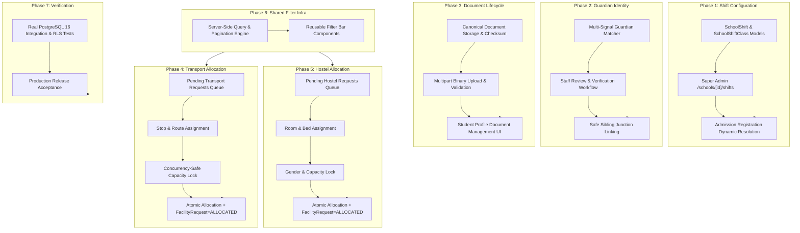

# SSVM ERP — Remaining Gap Register & Technical Specifications

**Document:** `docs/REMAINING_GAP_REGISTER.md`  
**Working Repository:** `pavo-bit/erp`  
**Target Branch:** `lane/d-portals`  
**Baseline Commit:** `97f2c9c`  
**Date:** 12 November 2026  
**Status:** Canonical Implementation Roadmap

---

## 1. Traceability & Scope Matrix

This register catalogues every remaining gap identified between the baseline implementation and production operational readiness across all 7 phases, assigning each to an exact architectural component, database model, API route, and user interface.

---

## 2. Phase 1 — Correct School Shift Configuration

### GAP 1.1: Comma-Separated Classes vs Normalized Class Model
- **Current State:** `SchoolShift` stores `applicableClasses String` as a comma-separated text string (e.g., `"Prarambha,Bodha,Class 1,Class 2,Class 3,Class 4,Class 5"`).
- **Target Specification:** Introduce normalized model `SchoolShiftClass`:
  - `id`: CUID Primary Key
  - `schoolId`: String (FK to `School`)
  - `shiftId`: String (FK to `SchoolShift`, onDelete: Cascade)
  - `classId`: String (FK to `Class`, onDelete: Cascade)
  - `sessionId`: String (FK to `AcademicSession`, onDelete: Cascade)
  - `isActive`: Boolean (default true)
  - Compound unique constraint: `@@unique([schoolId, sessionId, classId])` ensuring a class cannot be assigned to two active shifts in the same session.
- **Implementation Location:** `ssvm-backend/prisma/schema.prisma`, new migration `20261112150000_school_shift_classes`.

### GAP 1.2: Session-Awareness and Shift Versioning
- **Current State:** `SchoolShift` is globally scoped to `schoolId` with unique constraint `@@unique([schoolId, name])`. It lacks academic session scoping and versioning.
- **Target Specification:** Extend `SchoolShift` with:
  - `sessionId`: String? (FK to `AcademicSession`)
  - `version`: Int (default 1)
  - `isPublished`: Boolean (default true)
  - `publishedAt`: DateTime?
  - `createdById`: String?
- **Implementation Location:** `ssvm-backend/prisma/schema.prisma`.

### GAP 1.3: Super Admin Shift Configuration Interface
- **Current State:** No dedicated Super Admin interface exists to configure shifts per school and per academic session.
- **Target Specification:** Create page at `super-admin/src/app/dashboard/schools/[schoolId]/shifts/page.tsx`:
  - Select academic session.
  - Create, view, and edit Morning, Day, or Evening shifts with operational start and end times.
  - Multi-select institution classes populated directly from the school's actual `Class` records.
  - Conflict detection & validation: highlights unassigned classes and flags any overlapping class assignments.
  - Audit trail of historical shift configurations.
- **Implementation Location:** `super-admin/src/app/dashboard/schools/[schoolId]/shifts/page.tsx`.

### GAP 1.4: Dynamic Shift Resolution in Admission Registration
- **Current State:** `AdmissionRegistrationService.resolveOrCreateSchoolShift` uses hardcoded regular expressions: `const isMorning = /^(prarambha|prambha|bodha|class\s*[1-5])$/i.test(cName)`.
- **Target Specification:** Remove hardcoded regular expressions. Dynamically query `SchoolShiftClass` by `(schoolId, sessionId, classId)`:
  - If published shift assignment exists, assign `shiftId` to `StudentEnrollment`.
  - If no assignment exists for this class in the session, fail closed with explicit validation error: `NO_SHIFT_CONFIGURED_FOR_CLASS`.
  - Reject ambiguous configurations.
- **Implementation Location:** `ssvm-backend/src/services/admissions-bulk/admission-registration-service.ts`.

---

## 3. Phase 2 — Guardian Identity & Family Matching

### GAP 2.1: Phone-Only Identity Assumptions
- **Current State:** Registration searches for existing guardian by `primaryPhone` alone (`where: { schoolId, primaryPhone: phone }`). If found, it automatically links without name or address verification.
- **Target Specification:** Multi-signal matcher engine:
  - Match Signals: Normalized 10-digit phone number, sanitized name (Levenshtein distance or clean token match), primary email, address, and locality.
  - Scoring:
    - High Confidence (Exact phone + matching name + locality): Auto-linkable or marked for fast-track confirmation.
    - Potential Sibling (Same phone + different guardian name or address): Flag as `AMBIGUOUS_GUARDIAN_CANDIDATE`. Do not merge records automatically.
    - Distinct Guardian: Separate guardian entity created.
- **Implementation Location:** `ssvm-backend/src/services/admissions-bulk/guardian-matching.service.ts`.

### GAP 2.2: Staff Review Workflow for Ambiguous Matches
- **Current State:** Excel/CSV bulk import commits directly without presenting ambiguous family matches for staff attestation.
- **Target Specification:** In import preview and review workspace:
  - Flag students sharing a guardian phone where names diverge.
  - Staff can select: "Confirm Shared Sibling Guardian", "Create Distinct New Guardian", or "Link as Secondary Contact".
  - Decision audit logged with user ID, timestamp, and justification.
- **Implementation Location:** `ssvm-backend/src/routes/admin/admissions-bulk.ts`, `erp-admin/src/app/admin/admissions/page.tsx`.

---

## 4. Phase 3 — Unified Admission Document Workflow

### GAP 3.1: Two-Model Discrepancy (`Document` vs `DocumentRepository`)
- **Current State:** 
  - `ssvm-backend/src/routes/documents.ts` uses `DocumentRepository` (file metadata, versions, virus scan).
  - `ssvm-backend/src/routes/students.ts` and `admission-registration-service.ts` use `Document` (`ownerType`, `ownerId`, `verificationStatus: "PENDING_UPLOAD"`).
- **Target Specification:** Unify onto canonical `Document` model:
  - Standardize fields on `Document`: `schoolId`, `ownerType` (`STUDENT`), `ownerId`, `category`, `title`, `fileUrl`, `fileName`, `fileType`, `fileSize`, `checksum` (SHA-256), `verificationStatus` (`PENDING_UPLOAD`, `UPLOADED`, `VERIFIED`, `REJECTED`), `verifiedById`, `verifiedAt`, `rejectionReason`.
  - Maintain compatibility view or adapter for any legacy `DocumentRepository` callers.
- **Implementation Location:** `ssvm-backend/prisma/schema.prisma`, `ssvm-backend/src/routes/documents.ts`, `ssvm-backend/src/routes/students.ts`.

### GAP 3.2: Real Binary File Upload & Attachment Workflow
- **Current State:** Bulk registration creates document records with empty `fileUrl` and `verificationStatus: "PENDING_UPLOAD"`. There is no dedicated endpoint to attach actual binary uploads directly to these pending admission requirements.
- **Target Specification:**
  - `POST /api/v1/students/:id/documents/:documentId/upload`: Accepts multipart binary upload (PDF, JPEG, PNG, max 10MB).
  - Validates magic bytes (MIME type verification) and checks file size.
  - Calculates SHA-256 checksum and saves to Docker persistent volume storage (`/uploads/documents/`).
  - Updates `verificationStatus` from `PENDING_UPLOAD` to `UPLOADED`.
  - `PATCH /api/v1/students/:id/documents/:documentId/verify`: Admin approves (`VERIFIED`) or rejects (`REJECTED` with mandatory rejection reason).
  - Allows re-uploading against rejected documents with audit trail.
  - Authenticated file download endpoint streaming bytes with tenant access checks.
- **Implementation Location:** `ssvm-backend/src/routes/students.ts`, `ssvm-backend/src/services/document-storage.service.ts`.

### GAP 3.3: Canonical Student Profile Document UI
- **Current State:** `erp-admin/src/app/admin/students/[id]/page.tsx` displays documents in read-only list. Staff cannot upload files against pending records or verify/reject directly from the profile.
- **Target Specification:** Add interactive document controls in Student Profile Documents tab:
  - "Upload File" button for `PENDING_UPLOAD` and `REJECTED` items.
  - "Verify" and "Reject" buttons for staff with administrative permissions.
  - Modal to input rejection reason.
  - Download / preview action requesting authenticated signed URL.
- **Implementation Location:** `erp-admin/src/app/admin/students/[id]/page.tsx`.

---

## 5. Phase 4 — FacilityRequest Integration & Transport Allocation

### GAP 5.1: Missing "Pending Transport Requests" Tab in Transport Workspace
- **Current State:** `erp-admin/src/app/admin/transport/page.tsx` has Fleet, Routes, Drivers, Stops, Allocations, but no tab displaying unallocated students who requested transport during admission.
- **Target Specification:** Add "Pending Requests" tab:
  - Table of pending requests (`FacilityRequest` where `facilityType = "TRANSPORT"` and `status IN ("REQUESTED", "PENDING_REVIEW")`).
  - Columns: Student Name, Admission No, Class & Section, Shift, Locality, PIN Code, Landmark, Guardian Contact, Request Date.
  - Action button: "Allocate Transport".
- **Implementation Location:** `erp-admin/src/app/admin/transport/page.tsx`.

### GAP 5.2: Stop & Route Assignment with Concurrency-Safe Capacity Enforcement
- **Current State:** Existing `/api/v1/admin/transport/allocate` takes `studentId`, `stopId`, `monthCycle`. It does not lock vehicle capacity or check shift compatibility, and does not update `FacilityRequest`.
- **Target Specification:** Enhance transport allocation transaction:
  1. Verify student belongs to caller's `schoolId`.
  2. Resolve `stopId` -> `routeId` -> `vehicleId`.
  3. Acquire database row-level lock on Vehicle and Route allocations (`SELECT count(*) FROM transport_allocations WHERE ... FOR UPDATE`).
  4. Ensure active allocations do not exceed vehicle seating capacity.
  5. Create `TransportAllocation` record.
  6. Atomically update corresponding `FacilityRequest`:
     - `status = "ALLOCATED"`
     - `reviewedById = req.user.id`
     - `reviewedAt = new Date()`
     - `notes = "Allocated to Route X, Stop Y"`
- **Implementation Location:** `ssvm-backend/src/routes/admin/transport.ts`.

---

## 6. Phase 5 — FacilityRequest Integration & Hostel Allocation

### GAP 6.1: Missing "Pending Hostel Requests" Tab in Hostel Workspace
- **Current State:** `erp-admin/src/app/admin/hostel/page.tsx` has Rooms, Allocations, Maintenance, Analytics, but lacks a queue showing students requesting hostel rooms during admission.
- **Target Specification:** Add "Pending Requests" tab:
  - Table of students with `FacilityRequest` (`facilityType = "HOSTEL"`, `status IN ("REQUESTED", "PENDING_REVIEW")`).
  - Columns: Student Name, Admission No, Gender, Class, Locality, PIN Code, Guardian Phone, Request Notes.
  - Action button: "Assign Room".
- **Implementation Location:** `erp-admin/src/app/admin/hostel/page.tsx`.

### GAP 6.2: Room Assignment Connected to FacilityRequest with Atomic Reconciliation
- **Current State:** `/api/v1/ancillary/hostel/allocate` allocates student directly to room, but does not reconcile or link to admission `FacilityRequest`.
- **Target Specification:**
  - Add `requestId` optional parameter to allocation payload.
  - In atomic transaction:
    - Validate student gender matches room gender policy (`BOYS`, `GIRLS`, `COED`).
    - Verify room capacity using `FOR UPDATE` lock.
    - Create `HostelAllocation`.
    - Increment room occupancy.
    - If `requestId` provided, update `FacilityRequest` status to `ALLOCATED`.
  - On checkout/transfer (`/api/v1/ancillary/hostel/allocations/:id/checkout`), update `FacilityRequest` if all active hostel allocations terminate.
- **Implementation Location:** `ssvm-backend/src/routes/admin/ancillary.ts`.

---

## 7. Phase 6 — Shared Search & Filter Infrastructure

### GAP 7.1: Duplicate & Inconsistent Client-Side Filter Implementations
- **Current State:** Each operational workspace (Transport, Hostel, Students, Admissions) reimplements its own filters with inconsistent parameters and excessive client-side array filtering.
- **Target Specification:** Shared reusable filter standard:
  - Backend query builder helper `buildStandardStudentFilter(req.query, schoolId)` supporting:
    - `search` (name, admissionNo, rollNo, guardianPhone)
    - `sessionId`, `classId`, `sectionId`, `shiftId`
    - `locality`, `pincode`, `landmark`
    - `status` (student status or facility request status)
    - `isAllocated` (boolean filter)
    - Standardized pagination (`page`, `limit`, `sortBy`, `sortOrder`)
  - Shared frontend UI filter bar component: `erp-admin/src/components/shared/OperationalFilterBar.tsx`.
- **Implementation Location:** `ssvm-backend/src/lib/query-filters.ts`, `erp-admin/src/components/shared/OperationalFilterBar.tsx`.

---

## 8. Phase 7 — Security, Integration & Release Verification

### GAP 7.1: Comprehensive Test Coverage for Operational Workflows
- **Target Specification:** Implement full suite of end-to-end integration tests:
  - `ssvm-backend/src/tests/api/school-shifts.test.ts`: Super admin shift management, session isolation, conflict validation, registration shift assignment.
  - `ssvm-backend/src/tests/api/document-lifecycle.test.ts`: Upload real binary files, verify MIME type, calculate SHA-256 checksum, verify/reject lifecycle, download security, cross-tenant denial.
  - `ssvm-backend/src/tests/api/transport-facility-allocation.test.ts`: Pending transport queue retrieval, locality filters, vehicle capacity concurrency locking, atomic `FacilityRequest = ALLOCATED` state transition.
  - `ssvm-backend/src/tests/api/hostel-facility-allocation.test.ts`: Pending hostel queue, gender validation, room capacity locking, atomic `FacilityRequest = ALLOCATED` transition.
- **Implementation Location:** `ssvm-backend/src/tests/api/`.

