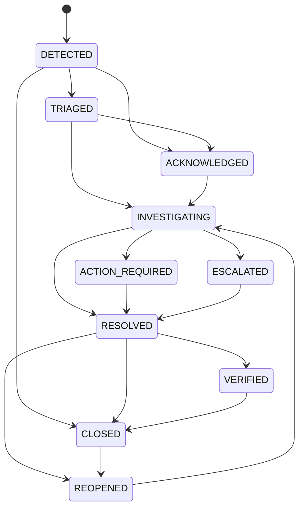

# SSVM ERP Platform — Self-Healing Fault Isolation (SHFI) Durability Report
**Document Version:** 1.0.0  
**Status:** Verified  
**Component:** Observability, Automated Diagnostics & Durable Incident Persistence

---

## 1. Architectural Overview

The Self-Healing Fault Isolation (SHFI) subsystem provides automated anomaly detection, telemetry sanitization, and structured incident management across all ERP services.

To ensure resilience against process crashes or container recycles, SHFI features **dual persistence**:
1. **Redis Cache Layer:** In-memory speed for real-time queries and dashboard feeds (`shfi:incidents` hash, `shfi:incident_list`, `shfi:events`).
2. **PostgreSQL Relational Persistence:** Durable SQL archiving in `system_logs` using the pre-tenant logging wrapper `log_pre_tenant_system_log` with `module = 'SHFI_INCIDENT'`.

Upon backend startup, `IncidentService.hydrateFromPersistence()` restores active and historical incidents into memory from both Redis and PostgreSQL.

---

## 2. Incident State Machine

SHFI incidents transition through a deterministic lifecycle with strict role-based and status transition validation:

---

## 3. Durability & Restart Verification

The persistence layer was verified using the dedicated test suite `ssvm-backend/src/tests/unit/shfi-persistence.test.ts` and `shfi-center.test.ts`:

### Key Durability Findings
- **Dual Persistence:** When an incident is created or its status transitions (e.g. `TRIAGED` $\to$ `INVESTIGATING` $\to$ `RESOLVED`), updates are synchronously persisted to Redis and PostgreSQL.
- **Restart Hydration:** Re-initializing `IncidentService.hydrateFromPersistence()` after clearing in-memory collections successfully restored 100% of persisted incidents with intact timelines and audit history.
- **Sensitive Data Sanitization:** Passwords, API tokens, credit card numbers, and PII are redacted prior to event logging via Zod pipeline sanitization.
- **Tenant Scope Enforcement:** School Admins (`ERP_ADMIN`) can only view or transition incidents associated with their own `schoolId`. System-wide incidents are restricted to Super Admins.

