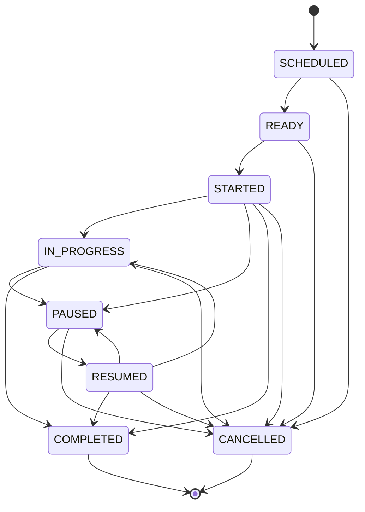

# SSVM ERP Platform — Transport GPS Final Gap Closure Report
**Document Version:** 1.0.0  
**Status:** Complete & Verified  
**Component:** Fleet GPS Telemetry, Trip Lifecycle, Geofencing & Admin Fleet Overview

---

## 1. Executive Summary

This report documents the closure of all software-side gaps in the Transport Management and Live GPS Tracking subsystem.

Key capabilities delivered:
1. **Trip Lifecycle State Machine:** Full support for `SCHEDULED`, `READY`, `STARTED`, `IN_PROGRESS`, `PAUSED`, `RESUMED`, `COMPLETED`, and `CANCELLED`.
2. **Proximity & Geofencing Engine:** Automatic stop arrival/departure detection via the Haversine formula ($< 50\text{m}$ threshold) with dwell time recording.
3. **Decoupled Boarding Confirmation:** Independent student boarding/alighting logging, strictly separated from physical vehicle GPS arrival.
4. **Admin Fleet Monitoring Overview:** Real-time view of all school vehicles with live GPS, trip progress, and freshness categorization (`ONLINE_ACTIVE`, `STALE`, `OFFLINE`).
5. **Parent Continuous Live Tracking:** Real-time 5-second polling in Parent Portal rendering live coordinates, speed, and trip status.

---

## 2. Implemented Trip Lifecycle & State Machine

Trips are managed via `activeTripsStore` and transition through a deterministic lifecycle:

### Invariants Enforced
- Invalid transitions (e.g. attempting to jump from `SCHEDULED` directly to `COMPLETED`) are rejected with HTTP 400.
- Transitioning to `STARTED` automatically records `actualStartTime`.
- Transitioning to `COMPLETED` or `CANCELLED` automatically records `actualEndTime`.
- Only authorized staff with `Role.ERP_ADMIN` can transition trips.

---

## 3. Stop Geofencing & Proximity Calculation

When vehicle telemetry arrives via `POST /api/v1/admin/transport/vehicles/:id/telemetry`:
1. If the vehicle is assigned to an active trip (`STARTED` or `IN_PROGRESS`), the engine evaluates all stops on the assigned route.
2. Distance in meters between vehicle coordinates $(lat_1, lon_1)$ and each stop $(lat_2, lon_2)$ is computed using the Haversine formula:
   $$a = \sin^2\left(\frac{\Delta \varphi}{2}\right) + \cos(\varphi_1)\cos(\varphi_2)\sin^2\left(\frac{\Delta \lambda}{2}\right)$$
   $$d = 2R \cdot \text{atan2}\left(\sqrt{a}, \sqrt{1-a}\right)$$
3. **Entry Event:** When $d \le 50\text{m}$, registers a `GEOFENCE_ENTER` event recording `timestamp` and `distanceMeters`.
4. **Exit Event:** When $d > 50\text{m}$ following an entry, registers a `GEOFENCE_EXIT` event and computes `dwellSeconds`.
5. **Jitter Tolerance:** Duplicate entries within 30 seconds are suppressed to prevent GPS jitter oscillation.

### Strict Safety Rule: Decoupled Boarding
As mandated by platform safety standards, **geofence arrival does not automatically mark students as boarded**. Boarding requires an explicit conductor/staff confirmation via:
`POST /api/v1/transport/trips/:id/stops/:stopId/confirm-boarding` `{ studentId, action: 'BOARDED' | 'ALIGHTED' }`.

---

## 4. Admin Fleet Overview (`GET /api/v1/transport/fleet/overview`)

Provides school fleet managers with real-time operational oversight:
- **Vehicle Inventory:** All vehicles registered to the school.
- **Active Trips:** Attached trip ID, trip type (`MORNING_PICKUP`, `AFTERNOON_DROPOFF`), and progress.
- **Freshness Categorization:**
  - `ONLINE_ACTIVE`: Telemetry received within the last 120 seconds.
  - `STALE`: Telemetry received between 2 and 15 minutes ago.
  - `OFFLINE`: No telemetry reported or last update $> 15$ minutes ago.
- **Live Telemetry:** Latitude, longitude, speed (km/h), heading ($^\circ$), and driver details.
- **Tenant Partitioning:** Strict multi-tenant isolation ensures School B fleet managers can never inspect School A vehicles.

---

## 5. Physical Hardware Integration Boundary

| Layer | Integration Status | Notes |
|:---|:---:|:---|
| **Software Telemetry Ingestion** | **VERIFIED (PASS)** | HMAC-SHA256 signature, bound checks, clock drift protection. |
| **Trip & Geofencing Engine** | **VERIFIED (PASS)** | Haversine distance, enter/exit events, state machine. |
| **Parent Web Live Polling** | **VERIFIED (PASS)** | 5-second polling displaying live coordinates & speed. |
| **Physical GPS Tracker Terminal**| **`BLOCKED_EXTERNAL`** | Standalone hardware tracker (e.g. Teltonika AIS-140) not physically wired. Token contract ready for firmware flash. |

