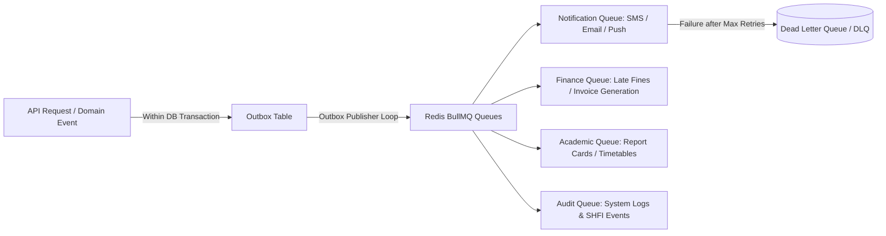

# Operational Runbook: Queue & Notification Subsystem Recovery
**Document ID:** RB-QUE-006  
**Target Infrastructure:** Redis 7 + BullMQ Queue Workers + Outbox Publisher  
**Audience:** Backend Engineers, SREs, Platform Operators  
**Classification:** Operational Procedure  

---

## 1. Queue Architecture & Responsibilities
The ERP handles background processing via Redis-backed BullMQ queues and transactional outbox tables:



---

## 2. Queue Health Metrics & Thresholds

| Metric | Normal Range | Warning Threshold | Critical Incident SLA |
| :--- | :--- | :--- | :--- |
| **Active Jobs** | 0 – 50 | > 100 | > 500 (Worker Stalled) |
| **Waiting Jobs** | 0 – 20 | > 50 | > 200 (Backlog Accumulating) |
| **Failed Jobs (DLQ)** | 0 | > 5 | > 20 (Provider Failure / Malformed Data) |
| **Job Execution Time** | < 2s | > 5s | > 30s (Lock Contention or Third-party Timeout) |

---

## 3. Operational Recovery Procedures

### 3.1 Inspecting Queue Backlog & Dead-Letter Jobs
Query BullMQ queue state in Redis:
```bash
# Check queue lengths in Redis
docker exec ssvm-redis redis-cli hgetall "bull:notifications:meta"
docker exec ssvm-redis redis-cli zcard "bull:notifications:failed"
docker exec ssvm-redis redis-cli zcard "bull:notifications:waiting"
```

Or query via the internal maintenance API:
```bash
curl -s -H "Authorization: Bearer $SUPER_ADMIN_TOKEN" \
  http://localhost:5000/api/v1/admin/queues/status
```

---

### 3.2 Retrying Failed Jobs from DLQ
If third-party notification services (e.g., Twilio or SMTP gateway) experienced a temporary outage, retry all accumulated failed jobs:

```bash
# Trigger retry of failed notification jobs
curl -X POST http://localhost:5000/api/v1/admin/queues/notifications/retry-failed \
  -H "Authorization: Bearer $SUPER_ADMIN_TOKEN"
```

Alternatively, invoke Redis CLI to move failed keys back to waiting:
```bash
docker exec ssvm-redis redis-cli eval "
  local failed = redis.call('zrange', KEYS[1], 0, -1)
  for _, id in ipairs(failed) do
    redis.call('zrem', KEYS[1], id)
    redis.call('rpush', KEYS[2], id)
  end
  return #failed
" 2 "bull:notifications:failed" "bull:notifications:wait"
```

---

### 3.3 Resolving Stalled BullMQ Workers
**Symptoms:** Jobs remain in `active` state indefinitely without completing or failing.

**Mitigation:**
1. Restart the backend worker process:
   ```bash
   docker restart ssvm-backend
   ```
2. Upon restart, BullMQ's built-in `stalledInterval` (default: 30s) automatically detects orphan jobs and reassigns them to active workers or marks them failed according to retry policy.

---

### 3.4 Outbox Publisher Loop Stuck Recovery
If records in PostgreSQL outbox table are not transitioning to `PUBLISHED`:
1. Check the oldest unpublished outbox events:
   ```sql
   SELECT id, "eventType", "createdAt", status, "retryCount", "lastError" 
   FROM outbox_events 
   WHERE status = 'PENDING' 
   ORDER BY "createdAt" ASC LIMIT 10;
   ```
2. Reset retry counts for transient network errors:
   ```sql
   UPDATE outbox_events 
   SET status = 'PENDING', "retryCount" = 0, "lastError" = NULL 
   WHERE status = 'FAILED' AND "createdAt" >= NOW() - INTERVAL '6 hours';
   ```

---

### 3.5 Emergency Queue Purging (Controlled Drainage)
In non-production or test environments where test messages clog the pipeline:
```bash
# Purge all waiting jobs in notifications queue
docker exec ssvm-redis redis-cli del "bull:notifications:wait" "bull:notifications:active"
```
*(Caution: Never execute in production without customer impact approval).*

