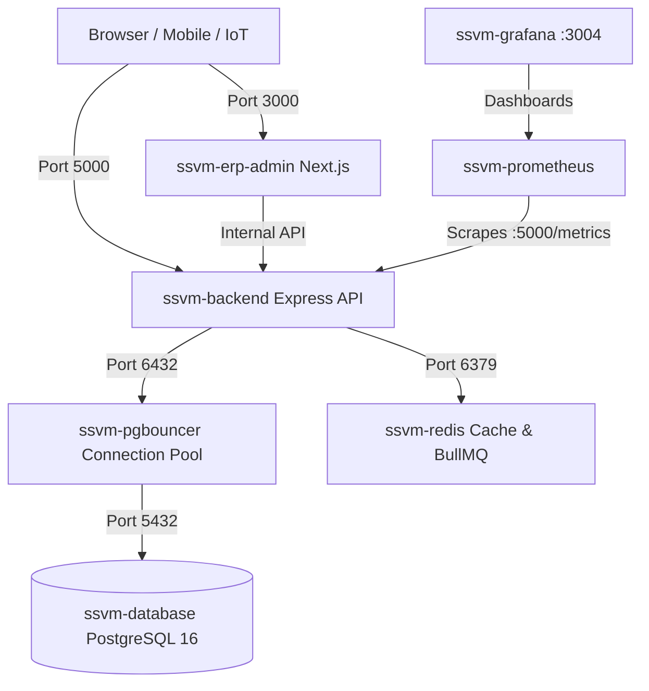

# Operational Runbook: Service Outage Recovery & Incident Escalation
**Document ID:** RB-OPS-003  
**Target Services:** `ssvm-backend`, `ssvm-erp-admin`, `ssvm-database`, `ssvm-redis`, `ssvm-pgbouncer`  
**Audience:** Site Reliability Engineers, DevOps Engineers, System Administrators  
**Classification:** Operational Procedure  

---

## 1. Architecture & Service Topology



---

## 2. Health Probes & Triage Verification

Whenever an outage or partial degradation is reported, evaluate health probes in order:

| Probe | Endpoint | Expected Result | Interpretation if Failing |
| :--- | :--- | :--- | :--- |
| **Liveness** | `GET :5000/api/v1/health/liveness` | `200 {"status":"UP"}` | Process hung or event loop blocked; container restart required. |
| **Readiness** | `GET :5000/api/v1/health/readiness` | `200 {"ready":true}` | Backend alive but DB or Redis disconnected; traffic must not be routed. |
| **Deep Health** | `GET :5000/api/v1/health/deep` | `200 {"overallStatus":"HEALTHY"}` | Specific dependency degraded (e.g. S3 storage, secondary database). |
| **DB Identity** | `GET :5000/api/v1/health/database-identity` | `200 {"currentUser":"ssvm_app", ...}` | Database misconfigured or RLS bypass anomaly detected. |

---

## 3. Failure Diagnostic & Recovery Playbooks

### Playbook A: Database Connection Pool Exhaustion (PgBouncer Error)
**Symptoms:** `FATAL: remaining connection slots are reserved for non-replication superuser connections` or `server login has been failing, too many clients`.

**Diagnostic Steps:**
1. Inspect PgBouncer status:
   ```bash
   docker exec -it ssvm-pgbouncer psql -U postgres -p 6432 pgbouncer -c "SHOW POOLS;"
   docker exec -it ssvm-pgbouncer psql -U postgres -p 6432 pgbouncer -c "SHOW CLIENTS;"
   ```
2. Inspect active queries in PostgreSQL:
   ```bash
   docker exec ssvm-database psql -U postgres -d ssvm_platform -c "
     SELECT pid, usename, client_addr, state, query_start, query 
     FROM pg_stat_activity 
     WHERE state != 'idle' 
     ORDER BY query_start ASC LIMIT 10;
   "
   ```
3. **Mitigation:**
   - Terminate long-running or blocking queries:
     ```sql
     SELECT pg_terminate_backend(<pid>);
     ```
   - Restart PgBouncer connection pooler:
     ```bash
     docker restart ssvm-pgbouncer
     ```

---

### Playbook B: Redis Failure or Memory Eviction
**Symptoms:** BullMQ job delays, session cache misses, `OOM command not allowed when used memory > 'maxmemory'`.

**Diagnostic Steps:**
1. Check Redis memory and client connections:
   ```bash
   docker exec ssvm-redis redis-cli info memory
   docker exec ssvm-redis redis-cli info clients
   ```
2. Verify queue sizes:
   ```bash
   docker exec ssvm-redis redis-cli dbsize
   ```
3. **Mitigation:**
   - Evict ephemeral keys:
     ```bash
     docker exec ssvm-redis redis-cli memory purge
     ```
   - Restart Redis container:
     ```bash
     docker restart ssvm-redis
     ```
   - Verify backend auto-reconnects:
     ```bash
     docker logs --tail 50 ssvm-backend | grep "Redis connected"
     ```

---

### Playbook C: Backend Process Crash or Out-Of-Memory (OOM)
**Symptoms:** Container restart loops, `Exit Code 137` in docker ps.

**Diagnostic Steps:**
1. Inspect docker exit state:
   ```bash
   docker inspect ssvm-backend --format='{{.State.ExitCode}} {{.State.OOMKilled}}'
   ```
2. Inspect last stack trace:
   ```bash
   docker logs --tail 100 ssvm-backend
   ```
3. **Mitigation:**
   - Clean startup restart:
     ```bash
     docker restart ssvm-backend
     ```
   - Verify SHFI event and incident hydration:
     ```bash
     docker logs ssvm-backend | grep "hydrated from"
     ```

---

## 4. Cold Boot & Recovery Sequence
When restoring the complete platform from a cold stop or power outage, bring up services in strict dependency order:

1. **Step 1: Storage & State Engines**
   ```bash
   docker compose up -d database redis
   ```
   Wait until healthy:
   ```bash
   docker compose ps
   ```

2. **Step 2: Connection Pooling & Proxy**
   ```bash
   docker compose up -d pgbouncer
   ```

3. **Step 3: Core API Backend**
   ```bash
   docker compose up -d backend
   ```
   Verify readiness:
   ```bash
   curl -f http://localhost:5000/api/v1/health/readiness
   ```

4. **Step 4: Web Portals & Observability**
   ```bash
   docker compose up -d erp-admin prometheus grafana alertmanager
   ```

