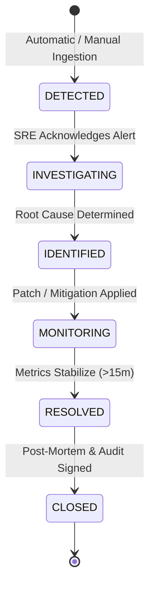

# Operational Runbook: SHFI Incident Response & Triage
**Document ID:** RB-SHFI-001  
**Target Architecture:** Multi-School SaaS Modular Monolith  
**Audience:** Site Reliability Engineers, Platform Operations, Super Admins  
**Classification:** Operational Procedure  

---

## 1. Overview & Purpose
The System Health, Failure Investigation & Incident Management Centre (SHFI) is the centralized operational nervous system of the multi-school SaaS ERP. This runbook defines the canonical response procedures for incoming diagnostic alerts, automated threshold breaches, and manual incident escalations.

All incidents and diagnostic events are durably persisted in Redis (`shfi:incidents`, `shfi:events`) and PostgreSQL (`system_logs` via the `SECURITY DEFINER` function `log_pre_tenant_system_log`), guaranteeing multi-instance hydration across backend container restarts.

---

## 2. Severity Classification Matrix

| Severity | Criteria | Response SLA | Required Responders |
| :--- | :--- | :--- | :--- |
| **SEV1 - Critical** | Total platform outage, database write freeze, tenant isolation breach, double-entry ledger imbalance, payment reconciliation corruption. | < 15 minutes | Lead Platform Architect, SRE On-call, Security Lead |
| **SEV2 - Major** | Degraded performance (>500ms API latency), BullMQ queue stall (>100 failed jobs), single-tenant degraded service, SMS/Email delivery outage. | < 45 minutes | Backend Engineer On-call, SRE |
| **SEV3 - Moderate** | Non-critical reporting timeout, single background task failure with retry, minor frontend telemetry drop, transport hardware clock drift. | < 4 hours | Module Engineer |
| **SEV4 - Low** | Informational alert, intermittent diagnostic warning, scheduled maintenance notification. | Next Business Day | Platform Operations |

---

## 3. Incident Lifecycle & State Machine
Incidents advance strictly through 6 validated states:



---

## 4. Operational Incident Triage Workflow

### Step 1: Accessing the SHFI Console
1. Navigate to Super Admin Portal: `https://<admin-domain>/super-admin/shfi` (or local dev: `http://localhost:3000/super-admin/shfi`).
2. Alternatively, query the REST API directly:
   ```bash
   # List active incidents
   curl -s -H "Authorization: Bearer $SUPER_ADMIN_TOKEN" \
     http://localhost:5000/api/v1/shfi/incidents?status=INVESTIGATING
   ```

### Step 2: Ingesting & Correlating Diagnostic Events
Review recent buffered telemetry:
```bash
# Query recent events with optional severity and module filters
curl -s -H "Authorization: Bearer $SUPER_ADMIN_TOKEN" \
  "http://localhost:5000/api/v1/shfi/events?limit=50&severity=CRITICAL"
```
Key correlation fields:
- `fingerprint`: Identifies duplicate or recurring cascade events.
- `schoolId`: Pinpoints whether failure is tenant-isolated or platform-wide.
- `module`: Target subsystem (`FINANCE`, `AUTH`, `TRANSPORT`, `ATTENDANCE`, `EXAMS`).

### Step 3: Transitioning Incident State
When actively debugging:
```bash
# Transition state to INVESTIGATING
curl -X POST http://localhost:5000/api/v1/shfi/incidents/<incident-id>/transition \
  -H "Authorization: Bearer $SUPER_ADMIN_TOKEN" \
  -H "Content-Type: application/json" \
  -d '{
    "toStatus": "INVESTIGATING",
    "reason": "Investigating payment webhook timeout spike across tenants"
  }'
```

### Step 4: Investigating Container Logs & PostgreSQL Audit Logs
1. Inspect live container logs:
   ```bash
   docker logs --tail 200 -f ssvm-backend
   ```
2. Query durable system audit logs via superuser SQL:
   ```bash
   docker exec ssvm-database psql -U postgres -d ssvm_platform -c "
     SELECT \"createdAt\", level, module, message, \"schoolId\" 
     FROM system_logs 
     WHERE level IN ('CRITICAL', 'ERROR') 
     ORDER BY \"createdAt\" DESC LIMIT 20;
   "
   ```

### Step 5: Mitigation & Escalation
- If a BullMQ worker is stuck, invoke the Queue Recovery procedure (`RB-QUEUE-006`).
- If an outbox message publisher is stalled, restart the background processor.
- If data corruption is suspected, initiate Point-In-Time-Recovery assessment (`RB-DB-002`).

### Step 6: Post-Incident Resolution & Close
Once telemetry confirms operational stability for at least 15 minutes:
```bash
curl -X POST http://localhost:5000/api/v1/shfi/incidents/<incident-id>/transition \
  -H "Authorization: Bearer $SUPER_ADMIN_TOKEN" \
  -H "Content-Type: application/json" \
  -d '{
    "toStatus": "RESOLVED",
    "reason": "Payment webhook retry backoff adjusted; backlog cleared."
  }'
```
Record post-mortem actions and mark `CLOSED` with incident post-mortem reference.

