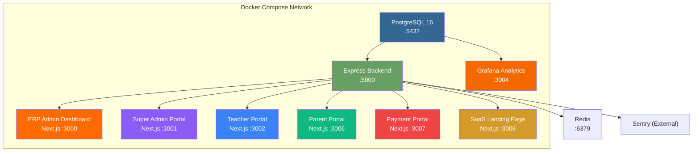
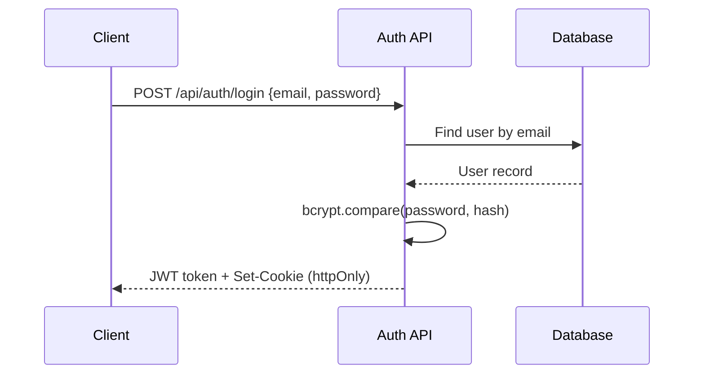
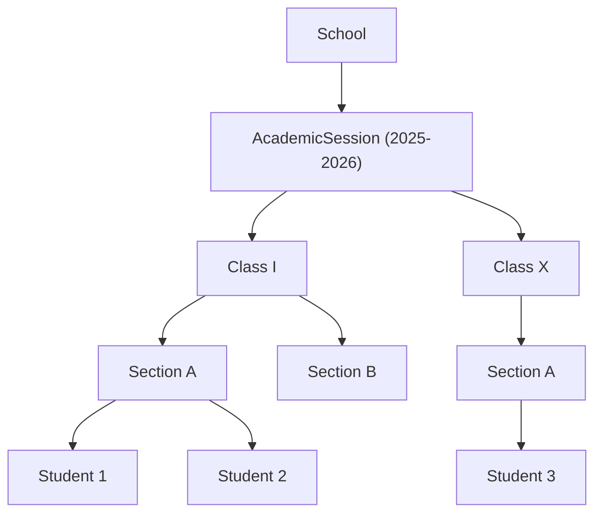
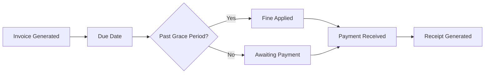
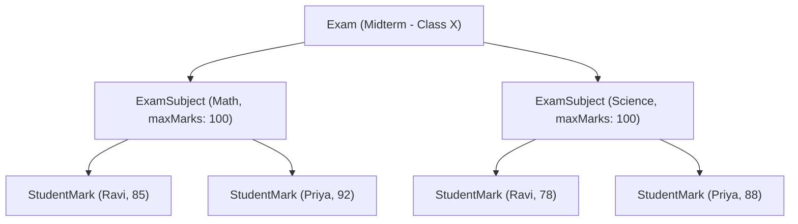
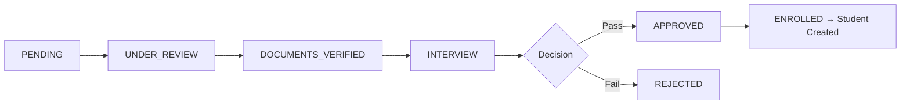

# SSVM College Square — Full Platform Documentation

> **Version**: 3.1.0 | **Last Updated**: June 17, 2026  
> **Base URL**: `http://localhost:5000` (Backend API)  
> **Stack**: Node.js / Express / Prisma / PostgreSQL / Next.js

---

## Table of Contents

1. [System Architecture](#1-system-architecture)
2. [Authentication & Authorization](#2-authentication--authorization)
3. [Database Schema (ERD)](#3-database-schema-erd)
4. [Backend API Reference](#4-backend-api-reference)
5. [Frontend Application Structure](#5-frontend-application-structure)
6. [Environment Configuration](#6-environment-configuration)

---

## 1. System Architecture



### Service Map

| Service | Container | Port | Technology | Purpose |
|---|---|---|---|---|
| **Database** | `ssvm-database` | `5432` | PostgreSQL 16 Alpine | Primary data store |
| **Backend API** | `ssvm-backend` | `5000` | Express + Prisma + TypeScript | REST API server |
| **ERP Admin** | `ssvm-erp-admin` | `3000` | Next.js 16 | School admin dashboard |
| **Super Admin** | `ssvm-super-admin` | `3001` | Next.js 16 | Platform-wide management |
| **Teacher Portal** | `ssvm-teacher-portal` | `3002` | Next.js 16 | Teacher-facing portal |
| **Parent Portal** | `ssvm-parent-portal` | `3006` | Next.js 16 | Parent and student dashboard |
| **Payment Portal** | `ssvm-payment-portal` | `3007` | Next.js 16 | Dedicated student fee payment portal |
| **SaaS Landing** | `ssvm-saas-frontend` | `3008` | Next.js 16 | Public Greyscales registration & marketing |
| **Grafana** | `ssvm-grafana` | `3004` | Grafana Enterprise | Analytics & monitoring |
| **Redis Cache** | `ssvm-redis` | `6379` | Redis 7 Alpine | Rate limits, Caching, BullMQ |
| **Sentry** | `External` | `-` | @sentry/node | Error tracking & profiling |

### Backend Directory Structure

```
ssvm-backend/
├── prisma/
│   ├── schema.prisma          # 62 models, 15 enums, 1424 lines
│   └── migrations/
│       └── 20260612100205_add_phase_10a_features/
├── src/
│   ├── index.ts               # Express app entry point (30 route mounts)
│   ├── config/
│   │   └── env.ts             # Environment validation
│   ├── lib/
│   │   ├── prisma.ts          # Prisma client singleton
│   │   └── logger.ts          # Pino logger
│   ├── middleware/
│   │   ├── auth.ts            # JWT + RBAC middleware
│   │   ├── errorHandler.ts    # Global error handler
│   │   ├── tenant.ts          # Multi-tenant school scoping
│   │   └── validate.ts        # Zod schema validation
│   ├── validators/
│   │   └── schemas.ts         # Zod validation schemas
│   └── routes/                # 30 route files
│       ├── auth.ts            # Authentication & login
│       ├── users.ts           # User management (CRUD, role assign, password reset)
│       ├── schools.ts         # School CRUD + setup
│       ├── branches.ts        # Branch management
│       ├── academic.ts        # Sessions, Classes, Sections, ClassTeachers
│       ├── students.ts        # Student CRUD
│       ├── teachers.ts        # Teacher CRUD
│       ├── invoices.ts        # Invoice CRUD + payment recording
│       ├── finance.ts         # Defaulters, monthly fee generation
│       ├── payments.ts        # Razorpay integration + late fines
│       ├── exams.ts           # Exam CRUD, marks entry, report cards
│       ├── attendance.ts      # Student attendance
│       ├── assignments.ts     # Assignments, submissions, grading, study materials
│       ├── admissions.ts      # Application pipeline
│       ├── hr.ts              # Salaries, payslips, leaves
│       ├── timetable.ts       # Timetable & slot management
│       ├── notices.ts         # Notice board CRUD
│       ├── events.ts          # Event CRUD
│       ├── notifications.ts   # SMS/Email/WhatsApp + templates
│       ├── communications.ts  # Communication templates + send + logs
│       ├── gallery.ts         # Image upload & gallery
│       ├── alumni.ts          # Alumni profiles & contributions
│       ├── cms.ts             # Testimonials, site content, analytics
│       ├── stats.ts           # Dashboard stats (public, detailed, activity feed)
│       ├── reports.ts         # PDF receipts, report cards, attendance export
│       ├── subscriptions.ts   # SaaS plan management + payments
│       ├── search.ts          # Global cross-entity search
│       ├── bulk.ts            # CSV bulk import with validation pipeline
│       ├── activity.ts        # Activity log feed
│       └── saas.ts            # SaaS registration & approval logic
├── Dockerfile
└── entrypoint.sh
```

---

## 2. Authentication & Authorization

### Authentication Flow



### Login Types

| Login Type | Endpoint | Credentials |
|---|---|---|
| **Staff/Admin** | `POST /api/auth/login` | email + password |
| **Student** | `POST /api/auth/student/login` | admissionNo + password |
| **Alumni** | `POST /api/auth/alumni/register` | Self-registration (public) |

### JWT Payload

```json
{
  "id": "cuid_user_id",
  "email": "admin@ssvm.edu.in",
  "role": "ERP_ADMIN",
  "name": "Admin User",
  "schoolId": "cuid_string"
}
```

### Role-Based Access Control (RBAC) Matrix

| Role | Scope | Permissions |
|---|---|---|
| `SUPER_ADMIN` | Platform-wide | Full access to all schools, users, and configurations |
| `ERP_ADMIN` | Single school | Manage students, teachers, fees, exams, notices within their school |
| `WEBSITE_ADMIN` | Single school | Manage CMS, gallery, testimonials, notices, events |
| `TEACHER` | Own school | View students, mark attendance, manage results, view timetable |
| `ACCOUNTANT` | Single school | Fee management and financial reports |
| `HR` | Single school | Salary and leave management |
| `LIBRARIAN` | Single school | Library management (future module) |
| `RECEPTIONIST` | Single school | Front-desk operations |
| `ASSET_MANAGER` | Single school | Inventory management, asset tracking, stock monitoring, procurement |
| `PARENT` | Own children | View own children's attendance, results, fees |
| `ALUMNI` | Self | View/update own alumni profile |
| `STUDENT` | Self | View own results, attendance, assignments |

### Middleware Stack

| Middleware | Function | Description |
|---|---|---|
| `authenticate` | Required auth | Verifies JWT, attaches `req.user` |
| `optionalAuth` | Optional auth | Attaches user if token present, continues otherwise |
| `requireRole(...roles)` | Role guard | Restricts to specific roles |
| `requireAdmin()` | Admin shortcut | `SUPER_ADMIN`, `ADMIN`, `ERP_ADMIN`, `WEBSITE_ADMIN` |
| `requireTeacherOrAdmin()` | Teacher+ | Admin roles + `TEACHER` |
| `requireSuperAdmin()` | Platform admin | `SUPER_ADMIN` only |
| `requireSchoolAccess()` | Tenant guard | Ensures users can only access their own school's data |
| `schoolContextMiddleware` | Tenant Isolation | Injects `app.current_school_id` into Prisma via AsyncLocalStorage |
| `bruteForceCheck` | Rate Limiting | Progressive delay (up to 1hr lockout) for failed auth attempts |
| `securityHeaders` | WAF/Sec Headers | Hardens response headers (HSTS, NoSniff, Frame-Options) |
| `rejectClosedPeriod` | Financial Guard | Blocks mutations on records within a CLOSED financial period |
| `metricsMiddleware` | SLO/SLI | Tracks request duration, active connections, and per-tenant usage |

---

## 3. Database Schema (ERD)

### Core Entity Relationship Diagram

```mermaid
erDiagram
    School ||--o{ Branch : has
    School ||--o| Subscription : has
    School ||--o{ AcademicSession : has
    School ||--o{ Department : has
    School ||--o{ Class : has
    School ||--o{ Student : has
    School ||--o{ Teacher : has
    School ||--o{ Subject : has
    School ||--o{ Invoice : has
    School ||--o{ FeeCategory : has
    School ||--o{ FeeStructure : has
    School ||--o{ FineRule : has
    School ||--o{ Exam : has
    School ||--o{ Timetable : has
    School ||--o{ Admission : has
    School ||--o{ Notice : has
    School ||--o{ Event : has
    School ||--o{ Notification : has
    School ||--o{ Salary : has
    School ||--o{ Attendance : has
    School ||--o{ Assignment : has
    School ||--o{ AuditLog : has
    School ||--o{ ActivityLog : has
    School ||--o{ TeacherSubjectAssignment : has
    School ||--o{ NotificationTemplate : has
    School ||--o{ Scholarship : has
    School ||--o| OnboardingProgress : has

    AcademicSession ||--o{ Class : contains
    Class ||--o{ Section : contains
    Section ||--o{ Student : enrolls
    Section ||--o{ Timetable : has
    Section ||--o{ Attendance : tracks
    Section ||--o{ ClassTeacher : assigned
    Section ||--o{ TeacherSubjectAssignment : maps

    User ||--o| Teacher : is
    User ||--o| Alumni : is
    User ||--o| Guardian : is
    User ||--o{ Notice : authors
    User ||--o{ Event : creates
    User ||--o{ AuditLog : generates

    Department ||--o{ Teacher : contains

    Teacher ||--o{ TeacherAttendance : has
    Teacher ||--o{ LeaveRequest : submits
    Teacher ||--o{ Salary : receives
    Teacher ||--o{ Attendance : marks
    Teacher ||--o{ ClassTeacher : assigned
    Teacher ||--o{ TeacherSubjectAssignment : maps
    Teacher ||--o{ Assignment : creates

    Guardian ||--o{ Student : parents
    Student ||--o{ Attendance : has
    Student ||--o{ StudentMark : receives
    Student ||--o{ Invoice : has
    Student ||--o{ AssignmentSubmission : submits
    Student ||--o{ StudentTimeline : has
    Student ||--o{ Scholarship : receives

    Subject ||--o{ ClassSubject : linked
    Subject ||--o{ TeacherSubject : linked
    Subject ||--o{ ExamSubject : tested
    Subject ||--o{ TeacherSubjectAssignment : assigned

    TeacherSubjectAssignment ||--o{ TimetableSlot : scheduled

    Exam ||--o{ ExamSubject : contains
    ExamSubject ||--o{ StudentMark : records

    Timetable ||--o{ TimetableSlot : contains

    Invoice ||--o{ PaymentTransaction : has
    FeeCategory ||--o{ FeeStructure : defines

    Assignment ||--o{ AssignmentSubmission : receives
    Assignment ||--o{ AssignmentAttachment : has

    Admission ||--o{ AdmissionLog : tracks
    Alumni ||--o{ Contribution : makes

    Subscription ||--o{ SubscriptionPayment : has
```

### Enums (15 Enums)

| Enum | Values |
|---|---|
| `Role` | `SUPER_ADMIN`, `ERP_ADMIN`, `WEBSITE_ADMIN`, `TEACHER`, `ACCOUNTANT`, `HR`, `LIBRARIAN`, `RECEPTIONIST`, `ASSET_MANAGER`, `PARENT`, `ALUMNI`, `STUDENT` |
| `DocumentOwnerType` | `STUDENT`, `TEACHER`, `ADMISSION`, `STAFF`, `SCHOOL` |
| `DocumentCategory` | `AADHAAR`, `BIRTH_CERTIFICATE`, `MARKSHEET`, `TC`, `ADMISSION_FORM`, `PASSPORT`, `OTHER` |
| `ActivityType` | `ADMISSION`, `PAYMENT`, `RESULT`, `ATTENDANCE`, `TEACHER`, `NOTICE` |
| `NoticeStatus` | `DRAFT`, `PUBLISHED`, `ARCHIVED` |
| `EventStatus` | `PLANNING`, `UPCOMING`, `COMPLETED`, `CANCELLED` |
| `InvoiceStatus` | `PAID`, `PENDING`, `OVERDUE`, `PARTIAL`, `UNPAID` |
| `FeeType` | `ADMISSION`, `READMISSION`, `MONTHLY`, `EXAM`, `TRANSPORT`, `HOSTEL`, `MISCELLANEOUS` |
| `AttendanceStatus` | `PRESENT`, `ABSENT`, `LATE`, `HOLIDAY` |
| `AssignmentStatus` | `PENDING`, `SUBMITTED`, `GRADED`, `LATE_SUBMITTED` |
| `LeaveStatus` | `PENDING`, `APPROVED`, `REJECTED` |
| `AdmissionStatus` | `PENDING`, `UNDER_REVIEW`, `DOCUMENTS_VERIFIED`, `INTERVIEW`, `APPROVED`, `REJECTED`, `ENROLLED` |
| `NotificationType` | `SMS`, `EMAIL`, `WHATSAPP` |
| `NotificationStatus` | `QUEUED`, `SENT`, `FAILED` |
| `SalaryStatus` | `PENDING`, `PAID`, `HOLD` |

### Model Summary (64 Models)

#### Tenant & Subscription (6 Models)

| # | Model | Table | Key Fields | Relations |
|---|---|---|---|---|
| 1 | `School` | `schools` | id, name, code, boardType, isActive | Central tenant entity |
| 2 | `Branch` | `branches` | id, schoolId, name, address, isActive | → School |
| 3 | `Subscription` | `subscriptions` | id, schoolId, planId, amount, status | → School (1:1), SubscriptionPlanConfig |
| 4 | `SubscriptionPlanConfig` | `subscription_plan_configs` | id, name, fixedPrice, billingCycle, features | → Subscription[] |
| 5 | `SubscriptionPayment` | `subscription_payments` | id, schoolId, subscriptionId, amountPaid | → Subscription, School |
| 6 | `SchoolRegistrationRequest` | `SchoolRegistrationRequest` | id, schoolName, principalName, email, status | Lead capturing for new SaaS tenants |

#### RBAC & Users (3 Models)

| # | Model | Table | Key Fields | Relations |
|---|---|---|---|---|
| 7 | `Permission` | `permissions` | id, name, description | → RolePermission[] |
| 8 | `RolePermission` | `role_permissions` | id, role, permissionId | → Permission |
| 9 | `User` | `users` | id, email, password, name, role, schoolId, branchId, employeeId, department, isActive, lastLogin | → Teacher?, Alumni?, Guardian? |
| 10 | `OTP` | `otps` | id, phone, code, expiresAt, verified | — |

#### Academic Structure (4 Models)

| # | Model | Table | Key Fields | Relations |
|---|---|---|---|---|
| 11 | `AcademicSession` | `academic_sessions` | id, schoolId, name, startDate, endDate, isCurrent | → School, Class[] |
| 12 | `Class` | `classes` | id, schoolId, sessionId, name, sortOrder | → School, AcademicSession, Section[] |
| 13 | `Section` | `sections` | id, classId, name, capacity | → Class, Student[], ClassTeacher[], Timetable[] |
| 14 | `ClassTeacher` | `class_teachers` | id, sectionId, teacherId, isPrimary | → Section, Teacher |

#### People (7 Models)

| # | Model | Table | Key Fields | Relations |
|---|---|---|---|---|
| 15 | `Department` | `departments` | id, schoolId, name | → School, Teacher[] |
| 16 | `Teacher` | `teachers` | id, userId, schoolId, branchId, departmentId, employeeId, designation | → User, School, Department, ClassTeacher[] |
| 17 | `Guardian` | `guardians` | id, userId, schoolId, primaryName, primaryPhone | → User?, Student[] |
| 18 | `Student` | `students` | id, schoolId, branchId, sectionId, guardianId, rollNo, admissionNo, name | → School, Branch?, Section?, Guardian?, StudentMark[] |
| 19 | `StudentTimeline` | `student_timeline` | id, studentId, title, type | → Student |
| 20 | `Alumni` | `alumni` | id, userId, batch, company, isFeatured | → User, Contribution[] |
| 21 | `Contribution` | `contributions` | id, alumniId, amount, purpose | → Alumni |

#### Attendance & HR (3 Models)

| # | Model | Table | Key Fields | Relations |
|---|---|---|---|---|
| 22 | `Attendance` | `attendance` | id, studentId, schoolId, sectionId, date, status, markedById | → Student, School, Section?, Teacher? |
| 23 | `TeacherAttendance` | `teacher_attendance` | id, teacherId, date, status | → Teacher |
| 24 | `LeaveRequest` | `leave_requests` | id, requesterId, leaveType, startDate, endDate, status | → Teacher |

#### Subjects & Timetable (6 Models)

| # | Model | Table | Key Fields | Relations |
|---|---|---|---|---|
| 25 | `Subject` | `subjects` | id, schoolId, name, code | → School, ClassSubject[], ExamSubject[], TeacherSubjectAssignment[] |
| 26 | `ClassSubject` | `class_subjects` | id, classId, subjectId | → Class, Subject |
| 27 | `TeacherSubject` | `teacher_subjects` | id, teacherId, subjectId | → Teacher, Subject |
| 28 | `TeacherSubjectAssignment` | `teacher_subject_assignments` | id, schoolId, teacherId, subjectId, sectionId, academicSessionId | → School, Teacher, Subject, Section, AcademicSession, TimetableSlot[] |
| 29 | `Timetable` | `timetables` | id, schoolId, sectionId, day | → School, Section, TimetableSlot[] |
| 30 | `TimetableSlot` | `timetable_slots` | id, timetableId, period, teacherSubjectAssignmentId, startTime, endTime | → Timetable, TeacherSubjectAssignment |

#### Exams & Results (3 Models)

| # | Model | Table | Key Fields | Relations |
|---|---|---|---|---|
| 31 | `Exam` | `exams` | id, schoolId, classId, name, isPublished | → School, Class, ExamSubject[] |
| 32 | `ExamSubject` | `exam_subjects` | id, examId, subjectId, maxMarks, passMarks, theoryMaxMarks, practicalMaxMarks | → Exam, Subject, StudentMark[] |
| 33 | `StudentMark` | `student_marks` | id, studentId, examSubjectId, marksObtained, grade, theoryMarksObtained, practicalMarksObtained | → Student, ExamSubject |

#### Notices & Events (2 Models)

| # | Model | Table | Key Fields | Relations |
|---|---|---|---|---|
| 34 | `Notice` | `notices` | id, schoolId, title, content, category, status, authorId | → School, User, Branch? |
| 35 | `Event` | `events` | id, schoolId, title, date, venue, category, status, creatorId | → School, User, Branch? |

#### Finance & Fees (5 Models)

| # | Model | Table | Key Fields | Relations |
|---|---|---|---|---|
| 36 | `FeeCategory` | `fee_categories` | id, schoolId, name | → School, FeeStructure[] |
| 37 | `FeeStructure` | `fee_structures` | id, schoolId, categoryId, classId, amount | → School, FeeCategory, Class? |
| 38 | `FineRule` | `fine_rules` | id, schoolId, graceDays, fineAmount, isPercentage | → School |
| 39 | `Invoice` | `invoices` | id, studentId, schoolId, amount, amountPaid, remainingAmount, fineAmount, type, status, dueDate | → Student, School, Branch?, PaymentTransaction[] |
| 40 | `PaymentTransaction` | `payment_transactions` | id, invoiceId, amountPaid, gateway, transactionId, status | → Invoice |

#### Assignments (4 Models)

| # | Model | Table | Key Fields | Relations |
|---|---|---|---|---|
| 41 | `Assignment` | `assignments` | id, schoolId, classId, teacherId, subjectId, title, dueDate, maxMarks, rubric, allowLate | → School, Class?, Teacher?, Subject, Attachment[], Submission[] |
| 42 | `AssignmentAttachment` | `assignment_attachments` | id, assignmentId, fileName, fileUrl, fileType | → Assignment |
| 43 | `AssignmentSubmission` | `assignment_submissions` | id, assignmentId, studentId, status, marksObtained, teacherFeedback, isLate | → Assignment, Student |
| 44 | `StudyMaterial` | `study_materials` | id, schoolId, classId, subjectId, title, fileUrl | → School, Class? |

#### Admissions (2 Models)

| # | Model | Table | Key Fields | Relations |
|---|---|---|---|---|
| 45 | `Admission` | `admissions` | id, schoolId, applicantName, applyingForClass, parentName, status | → School, AdmissionLog[], Branch? |
| 46 | `AdmissionLog` | `admission_logs` | id, admissionId, status, notes, changedById | → Admission |

#### Salary (1 Model)

| # | Model | Table | Key Fields | Relations |
|---|---|---|---|---|
| 47 | `Salary` | `salaries` | id, teacherId, schoolId, month, year, basicPay, allowances, deductions, netPay, status | → Teacher, School, Branch? |

#### Notifications & Templates (3 Models)

| # | Model | Table | Key Fields | Relations |
|---|---|---|---|---|
| 48 | `Notification` | `notifications` | id, schoolId, type, recipientPhone, subject, message, status, templateId | → School |
| 49 | `MessageTemplate` | `message_templates` | id, schoolId, name, category, channel, bodyTemplate `{{vars}}` | → School |
| 50 | `NotificationTemplate` | `notification_templates` | id, schoolId, name, type, content, isActive | → School |

#### CMS & Gallery (4 Models)

| # | Model | Table | Key Fields | Relations |
|---|---|---|---|---|
| 51 | `GalleryImage` | `gallery_images` | id, schoolId, title, category, imageUrl, isPublished | → School |
| 52 | `SiteContent` | `site_content` | id, schoolId, section, key, value, type | → School |
| 53 | `Testimonial` | `testimonials` | id, schoolId, name, role, content, rating, isPublished | → School |
| 54 | `Scholarship` | `scholarships` | id, schoolId, studentId, name, amount, approvedBy | → School, Student, User? |

#### Communications (2 Models)

| # | Model | Table | Key Fields | Relations |
|---|---|---|---|---|
| 55 | `CommunicationTemplate` | `communication_templates` | id, schoolId, name, channel, subject, content | → School |
| 56 | `CommunicationLog` | `communication_logs` | id, schoolId, recipientId, channel, type, content, status | → School |

#### Reports & Documents (2 Models)

| # | Model | Table | Key Fields | Relations |
|---|---|---|---|---|
| 57 | `ReportTemplate` | `report_templates` | id, schoolId, name, type, htmlContent, cssStyles | → School |
| 58 | `DocumentRepository` | `document_repository` | id, schoolId, studentId, teacherId, category, fileUrl, isVerified | → School |

#### Audit & Activity (3 Models)

| # | Model | Table | Key Fields | Relations |
|---|---|---|---|---|
| 59 | `AuditLog` | `audit_logs` | id, schoolId, userId, action, entity, entityId, details, ipAddress, hash, previousHash | → School, User |
| 60 | `ActivityLog` | `activity_logs` | id, schoolId, type, title, description, metadata(JSON) | → School |
| 61 | `Document` | `documents` | id, schoolId, ownerType, ownerId, category, fileUrl | → School |
| 62 | `OnboardingProgress` | `onboarding_progress` | id, schoolId, profileCompleted, academicSetupCompleted, studentsImported | → School (1:1) |
| 63 | `IdempotencyRecord` | `idempotency_records` | id, key, response, status, expiresAt | — |
| 64 | `SystemBackup` | `system_backups` | id, type, status, sizeBytes, fileUrl, checksum | — |

#### Library (2 Models)

| # | Model | Table | Key Fields | Relations |
|---|---|---|---|---|
| 65 | `Book` | `books` | id, schoolId, title, author, isbn, category, totalCopies, available | → School |
| 66 | `BookIssue` | `book_issues` | id, bookId, studentId, teacherId, issueDate, dueDate, returnDate, status, fineAmount | → Book, Student?, Teacher? |

---

## 4. Backend API Reference

> **Standard Response Format**:
> ```json
> { "success": true|false, "data": {...}, "error": "message" }
> ```
> 
> **API Versioning (Phase 12A.1)**:
> All API routes will be migrated to the `/api/v1/*` namespace globally. Backwards compatibility for unversioned routes will eventually be deprecated via the `Deprecation` header.

/api/v1/auth/refresh:
    post:
      summary: Refresh Access Token
      description: Issues a new access token using a valid refresh token. Rotates the refresh token and checks for family reuse.
      tags:
        - Authentication
      security: []
      requestBody:
        required: true
        content:
          application/json:
            schema:
              type: object
              required:
                - refreshToken
              properties:
                refreshToken:
                  type: string
                  description: The current refresh token.
      responses:
        "200":
          description: Token refreshed successfully
          content:
            application/json:
              schema:
                type: object
                properties:
                  success:
                    type: boolean
                  token:
                    type: string
                    description: New short-lived access token
                  refreshToken:
                    type: string
                    description: New rotated refresh token
        "401":
          description: Invalid or expired refresh token, or token family reused
  
  /api/v1/auth/logout:
    post:
      summary: Logout
      description: Logs the user out by blocklisting the token (JTI) in Redis and deactivating the session.
      tags:
        - Authentication
      security:
        - bearerAuth: []
      responses:
        "200":
          description: Logged out successfully

  /api/v1/search:
    get:
      summary: Global Full-Text Search
      description: Performs a fast `tsvector` indexed search across multiple entities (Students, Documents, Users) while enforcing RLS based on the user's role and school.
      tags:
        - Search
      security:
        - bearerAuth: []
      parameters:
        - in: query
          name: q
          schema:
            type: string
          required: true
          description: The search query (supports partial matches and lexemes)
      responses:
        "200":
          description: Search results

  /api/v1/payments/webhook:
    post:
      summary: Payment Webhook Receiver
      description: Receives webhook events from Razorpay. Verifies HMAC signatures, replay protections, and ensures payment idempotency.
      tags:
        - Webhooks
      security: []
      parameters:
        - in: header
          name: x-razorpay-signature
          required: true
          schema:
            type: string
          description: HMAC SHA256 Signature for webhook verification
      requestBody:
        required: true
        content:
          application/json:
            schema:
              type: object
      responses:
        "200":
          description: Webhook processed successfully or ignored idempotenly

  /api/v1/messages/threads:
    get:
      summary: Get Message Threads
      tags:
        - Messaging
      security:
        - bearerAuth: []
      responses:
        "200":
          description: List of message threads for the current user
    post:
      summary: Start New Thread
      tags:
        - Messaging
      security:
        - bearerAuth: []
      requestBody:
        required: true
        content:
          application/json:
            schema:
              type: object
              required:
                - subject
                - participantIds
              properties:
                subject:
                  type: string
                participantIds:
                  type: array
                  items:
                    type: string
      responses:
        "201":
          description: Thread created successfully

  /api/v1/messages/{threadId}:
    get:
      summary: Get Thread Messages
      tags:
        - Messaging
      security:
        - bearerAuth: []
      parameters:
        - in: path
          name: threadId
          required: true
          schema:
            type: string
      responses:
        "200":
          description: List of messages in the thread
    post:
      summary: Send Message to Thread
      tags:
        - Messaging
      security:
        - bearerAuth: []
      parameters:
        - in: path
          name: threadId
          required: true
          schema:
            type: string
      requestBody:
        required: true
        content:
          application/json:
            schema:
              type: object
              required:
                - content
              properties:
                content:
                  type: string
      responses:
        "201":
          description: Message sent and notifications queued

  /api/v1/messages/{threadId}/read:
    put:
      summary: Mark Thread as Read
      tags:
        - Messaging
      security:
        - bearerAuth: []
      parameters:
        - in: path
          name: threadId
          required: true
          schema:
            type: string
      responses:
        "200":
          description: Thread marked as read.

### 4.1 Auth — `/api/v1/auth`

> [!IMPORTANT]
> Auth endpoints are rate-limited: **10 requests per 15 minutes** per IP.

| Method | Endpoint | Auth | Description |
|---|---|---|---|
| `POST` | `/login` | ✗ | Authenticate staff/admin user, returns Access/Refresh JWTs |
| `POST` | `/student/login` | ✗ | Authenticate student with admissionNo + password |
| `POST` | `/register` | `ADMIN` | Create new user account |
| `POST` | `/alumni/register` | ✗ (public) | Alumni self-registration |
| `POST` | `/refresh` | ✗ | Exchange valid Refresh Token for a new Access Token |
| `GET` | `/me` | ✓ | Get current user profile |
| `POST` | `/logout` | ✗ | Clear auth cookies |

#### `POST /api/auth/login`

```json
// Request
{ "email": "admin@ssvm.edu.in", "password": "password123" }

// Response 200 (Success)
{
  "success": true,
  "data": {
    "user": { "id": "...", "email": "...", "name": "...", "role": "ERP_ADMIN", "schoolId": "..." }
  }
}
// Cookies Set: access_token (15m), refresh_token (30d)

// Response 200 (2FA Required)
{
  "success": true,
  "data": {
    "requires2FA": true,
    "pendingToken": "eyJhbGciOi...",
    "message": "Two-Factor Authentication required"
  }
}

// Response 401
{ "success": false, "error": "Invalid credentials" }

// Response 403
{ "success": false, "error": "Account deactivated" }
```

#### `POST /api/auth/refresh`

Rotates access token seamlessly in the background.

---

### 4.2 Two-Factor Authentication (2FA) — `/api/2fa`

> **Access**: Authenticated Users only

| Method | Endpoint | Auth | Description |
|---|---|---|---|
| `POST` | `/setup` | ✓ | Generate TOTP secret and QR code for authenticator app |
| `POST` | `/verify-setup` | ✓ | Verify authenticator code and enable 2FA |
| `POST` | `/disable` | ✓ | Disable 2FA using a valid code |
| `POST` | `/validate` | ✗ | Second step of login using `pendingToken` and TOTP code |

---

### 4.3 Server-Sent Events (SSE) — `/api/sse`

Provides real-time push notifications. Clients connect to `/api/sse/stream` to receive events.

| Method | Endpoint | Auth | Description |
|---|---|---|---|
| `GET` | `/stream` | ✓ | Establish SSE connection (heartbeat every 30s) |

---

### 4.4 Library Management — `/api/library`

| Method | Endpoint | Auth | Description |
|---|---|---|---|
| `GET` | `/books` | ✓ | List books (searchable by title, category, isbn) |
| `POST` | `/books` | Admin, Librarian | Add new book |
| `GET` | `/issues` | ✓ | List book issues (filterable by student, status) |
| `POST` | `/issues/issue` | Admin, Librarian | Issue a book to a student/teacher |
| `POST` | `/issues/return` | Admin, Librarian | Return an issued book, marks returned date (Generates Fine Invoice) |
| `GET` | `/overdue` | Admin, Librarian | List overdue book issues |

---

### 4.5 Asset Management — `/api/v1/assets`

> **Access**: `ASSET_MANAGER`, `ADMIN`, `SUPER_ADMIN`

| Method | Endpoint | Auth | Description |
|---|---|---|---|
| `GET` | `/` | ✓ | List all assets |
| `POST` | `/` | ✓ | Create a new asset |
| `GET` | `/categories` | ✓ | List asset categories |
| `GET` | `/vendors` | ✓ | List asset vendors |

---

### 4.6 Reception Management — `/api/v1/reception`

> **Access**: `RECEPTIONIST`, `ADMIN`, `SUPER_ADMIN`

| Method | Endpoint | Auth | Description |
|---|---|---|---|
| `GET` | `/enquiries` | ✓ | List admission enquiries |
| `POST` | `/enquiries` | ✓ | Create new admission enquiry |
| `GET` | `/visitors` | ✓ | List visitor logs |
| `POST` | `/visitors` | ✓ | Create a new visitor log |

---

### 4.7 Health Monitoring — `/api/health`

| Method | Endpoint | Auth | Description |
|---|---|---|---|
| `GET` | `/` | ✗ | Returns system health (Database, Redis, Queue, Storage). Version `3.0.0` |

---

### 4.8 User Management — `/api/users`

> **Access**: `SUPER_ADMIN`, `ERP_ADMIN` only

| Method | Endpoint | Auth | Description |
|---|---|---|---|
| `GET` | `/` | ERP Admin+ | List all users (filterable by role, search, pagination) |
| `POST` | `/` | ERP Admin+ | Create a new user with temporary password |
| `PUT` | `/:id` | ERP Admin+ | Update user details (role, department, employeeId) |
| `PUT` | `/:id/status` | ERP Admin+ | Enable/disable user account |
| `PUT` | `/:id/reset-password` | ERP Admin+ | Reset user password (generates temporary password) |

> [!NOTE]
> User creation generates a temporary password and logs the action to `AuditLog`. The UI displays the generated password for the admin to share with the user.

---

### 4.9 Schools — `/api/schools`

> **Access**: `SUPER_ADMIN` only

| Method | Endpoint | Auth | Description |
|---|---|---|---|
| `GET` | `/` | SUPER_ADMIN | List all schools |
| `GET` | `/:id` | SUPER_ADMIN | Get school details |
| `POST` | `/` | SUPER_ADMIN | Create new school |
| `POST` | `/:id/setup` | SUPER_ADMIN | Initial school setup (sessions, classes, fee categories) |
| `PUT` | `/:id` | SUPER_ADMIN | Update school |
| `DELETE` | `/:id` | SUPER_ADMIN | Delete school |
| `GET` | `/:id/stats` | SUPER_ADMIN | Get school statistics |

---

### 4.10 Branches — `/api/branches`

| Method | Endpoint | Auth | Description |
|---|---|---|---|
| `GET` | `/` | Auth | List branches for current school |
| `POST` | `/` | ERP Admin+ | Create branch |
| `PUT` | `/:id` | ERP Admin+ | Update branch |
| `DELETE` | `/:id` | SUPER_ADMIN | Delete branch |

---

### 4.11 Academic — `/api/academic`

> **Access**: Teacher+ for reads, Admin for writes

| Method | Endpoint | Auth | Description |
|---|---|---|---|
| `GET` | `/sessions` | Teacher+ | List academic sessions |
| `POST` | `/sessions` | Admin | Create academic session |
| `GET` | `/classes` | Teacher+ | List classes (filterable by sessionId) |
| `POST` | `/classes` | Admin | Create single class |
| `POST` | `/classes/bulk` | Admin | Bulk create classes |
| `GET` | `/sections` | Teacher+ | List sections for a class |
| `POST` | `/sections` | Admin | Create single section |
| `POST` | `/sections/bulk` | Admin | Bulk create sections |
| `POST` | `/class-teachers` | Admin | Assign class teacher to section |
| `GET` | `/class-teachers/:sectionId` | Teacher+ | Get class teachers for section |
| `DELETE` | `/class-teachers/:id` | Admin | Remove class teacher assignment |

#### Academic Hierarchy



---

### 4.12 Students — `/api/students`

| Method | Endpoint | Auth | Description |
|---|---|---|---|
| `GET` | `/` | Teacher+, Parent | List students (school-scoped, paginated) |
| `GET` | `/:id` | Auth | Get student details with guardian and section/class |
| `PUT` | `/:id` | Admin | Update student (sectionId, rollNo, guardianId, admissionNo, password) |

#### Query Filters

`GET /api/students?classId=xxx&sectionId=yyy&search=ravi&page=1&limit=20`

> [!NOTE]
> Students are linked to classes via `sectionId → Section → Class → AcademicSession`. The old string-based `class`/`section` fields have been removed. Parent users see only their own children via `guardianId`.

---

### 4.13 Teachers — `/api/teachers`

| Method | Endpoint | Auth | Description |
|---|---|---|---|
| `GET` | `/` | Teacher+ | List teachers (school-scoped) |
| `GET` | `/:id` | Teacher+ | Get teacher profile |
| `POST` | `/` | Admin | Create teacher + linked user account |
| `PUT` | `/:id` | Admin | Update teacher profile |
| `DELETE` | `/:id` | Admin | Deactivate teacher + disable user login |

> [!WARNING]
> **DELETE** performs a transaction: sets `teacher.isActive = false` AND `user.isActive = false`.

---

### 4.14 Invoices & Finance — `/api/invoices`, `/api/finance`

| Method | Endpoint | Auth | Description |
|---|---|---|---|
| `GET` | `/invoices` | Auth | List invoices (paginated, student/school scoped) |
| `POST` | `/invoices` | Admin | Create invoice |
| `PUT` | `/invoices/:id/pay` | Admin | Record payment on invoice |
| `GET` | `/finance/defaulters` | Admin | List fee defaulters |
| `POST` | `/finance/generate-monthly-fees` | Admin | Auto-generate monthly invoices for all active students |

#### Invoice Flow



---

### 4.15 Payments — `/api/payments`

| Method | Endpoint | Auth | Description |
|---|---|---|---|
| `POST` | `/create-order` | Auth | Create Razorpay payment order |
| `POST` | `/verify` | Auth | Verify Razorpay payment signature from client |
| `POST` | `/webhook` | ✗ (Razorpay) | Receive Razorpay webhook events (with signature validation, 5-min replay protection, and `gatewayPaymentId` idempotency) |
| `POST` | `/trigger-late-fines` | Auth | Apply late fines to overdue invoices |

---

### 4.16 Exams — `/api/exams`

| Method | Endpoint | Auth | Description |
|---|---|---|---|
| `GET` | `/` | Teacher+ | List exams (filterable by classId) |
| `POST` | `/` | Admin | Create exam (linked to classId) |
| `PUT` | `/:id` | Admin | Update exam |
| `DELETE` | `/:id` | Admin | Delete exam |
| `POST` | `/:id/marks` | Teacher+ | Submit/update marks for an exam |
| `GET` | `/:examId/report-card/:studentId` | Teacher+ | Generate student report card data |

#### Exam Architecture



---

### 4.17 Attendance — `/api/attendance`

| Method | Endpoint | Auth | Description |
|---|---|---|---|
| `GET` | `/` | Auth | List attendance records (filterable by studentId, date, classId) |
| `POST` | `/` | Teacher+ | Mark attendance for a student |

---

### 4.18 Assignments — `/api/assignments`

| Method | Endpoint | Auth | Description |
|---|---|---|---|
| `GET` | `/` | Auth | List assignments (filterable by classId, subjectId) |
| `POST` | `/` | Teacher+ | Create assignment with optional attachments |
| `POST` | `/:id/submit` | Student | Submit assignment |
| `POST` | `/submissions/:submissionId/grade` | Teacher+ | Grade a submission (marks, feedback, rubric scoring) |
| `GET` | `/study-materials` | Auth | List study materials (filterable by classId, subjectId) |

---

### 4.19 Admissions — `/api/admissions`

| Method | Endpoint | Auth | Description |
|---|---|---|---|
| `GET` | `/` | Admin | List admission applications |
| `POST` | `/apply` | ✗ (public) | Submit admission application |
| `PUT` | `/:id/review` | Admin | Update application status (review, approve, reject) |
| `POST` | `/:id/enroll` | Admin | Convert approved admission → Student record |
| `DELETE` | `/:id` | Admin | Delete application |

#### Admission Pipeline



---

### 4.20 HR & Payroll — `/api/hr`

| Method | Endpoint | Auth | Description |
|---|---|---|---|
| `GET` | `/salaries` | Admin | List salary records |
| `POST` | `/salaries` | Admin | Create salary entry |
| `PUT` | `/salaries/:id/pay` | Admin | Mark salary as paid |
| `GET` | `/payslips/:teacherId` | Teacher+ | Get teacher's payslips |
| `GET` | `/leaves` | Teacher+ | List leave requests |
| `POST` | `/leaves` | Teacher+ | Submit leave request |
| `PUT` | `/leaves/:id` | Admin | Approve/reject leave |

---

### 4.21 Timetable — `/api/timetable`

| Method | Endpoint | Auth | Description |
|---|---|---|---|
| `GET` | `/` | Teacher+ | Get timetable for a section |
| `GET` | `/teacher/:teacherId` | Teacher+ | Get teacher's personal schedule |
| `POST` | `/` | Admin | Create timetable with slots (uses `teacherSubjectAssignmentId`) |
| `DELETE` | `/:id` | Admin | Delete timetable |

> [!NOTE]
> Timetable slots reference `TeacherSubjectAssignment` which combines teacher + subject + section + session in a single relational link — no raw strings.

---

### 4.22 Messaging (Teacher ↔ Parent) — `/api/messages`

> **Note**: These endpoints represent the new Phase 12A Messaging Infrastructure.

| Method | Endpoint | Auth | Description |
|---|---|---|---|
| `GET` | `/threads` | Auth | List all message threads for the current user |
| `GET` | `/threads/:id/messages` | Auth | Fetch messages inside a specific thread |
| `POST` | `/threads/:id/messages` | Auth | Send a new message (supports `MessageAttachment`) |

---

### 4.23 Notifications — `/api/notifications`

| Method | Endpoint | Auth | Description |
|---|---|---|---|
| `POST` | `/send` | Admin | Enqueues a notification to the `NOTIFICATION_QUEUE` (BullMQ) |
| `GET` | `/history` | Admin | View sent notification logs |

> [!TIP]
> All notification dispatches (SMS, Email, WhatsApp) are processed asynchronously via the `NOTIFICATION_QUEUE` to prevent API latency spikes.

---

### 4.24 Notices & Events — `/api/notices`, `/api/events`

| Method | Endpoint | Auth | Description |
|---|---|---|---|
| `GET` | `/notices` | Optional | List notices (public + private based on auth) |
| `POST` | `/notices` | Admin | Create notice |
| `GET` | `/notices/:id` | ✗ (public) | Get single notice |
| `PUT` | `/notices/:id` | Admin | Update notice |
| `DELETE` | `/notices/:id` | Admin | Delete notice |
| `GET` | `/events` | ✗ (public) | List events |
| `POST` | `/events` | Admin | Create event |
| `PUT` | `/events/:id` | Admin | Update event |
| `DELETE` | `/events/:id` | Admin | Delete event |

---

### 4.23 Notifications — `/api/notifications`

| Method | Endpoint | Auth | Description |
|---|---|---|---|
| `POST` | `/send` | Admin | Send single notification (SMS/Email/WhatsApp) |
| `POST` | `/bulk` | Admin | Send bulk notifications |
| `GET` | `/` | Admin | List sent notifications |
| `POST` | `/fee-reminder` | Admin | Send fee payment reminders |
| `GET` | `/templates` | Admin | List notification templates |
| `POST` | `/templates` | Admin | Create notification template (supports `{{variables}}`) |
| `PUT` | `/templates/:id` | Admin | Update notification template |
| `DELETE` | `/templates/:id` | Admin | Delete notification template |

#### Template Variables

Templates support dynamic variables like:

```
Dear {{studentName}},

Your fee of ₹{{feeAmount}} is due on {{dueDate}}.

School: {{schoolName}}
Parent: {{parentName}}
Invoice: {{invoiceNumber}}
```

---

### 4.24 Communications — `/api/communications`

| Method | Endpoint | Auth | Description |
|---|---|---|---|
| `GET` | `/templates` | Admin | List communication templates |
| `POST` | `/templates` | Admin | Create communication template (Handlebars content) |
| `POST` | `/send` | Admin | Send communication using template |
| `GET` | `/logs` | Admin | List communication logs |

---

### 4.25 Gallery — `/api/gallery`

| Method | Endpoint | Auth | Description |
|---|---|---|---|
| `GET` | `/` | ✗ (public) | List gallery images (filterable by category) |
| `POST` | `/` | Admin | Upload image (multipart form) |
| `DELETE` | `/:id` | Admin | Delete image |

---

### 4.26 Alumni — `/api/alumni`

| Method | Endpoint | Auth | Description |
|---|---|---|---|
| `GET` | `/` | ✗ (public) | List alumni profiles |
| `PUT` | `/` | Admin | Update alumni profile |
| `GET` | `/contributions` | ✗ (public) | List alumni contributions |
| `POST` | `/contributions` | Admin, Alumni | Record contribution |

---

### 4.27 CMS — `/api/testimonials`, `/api/site-content`, `/api/analytics`

> Mounted as `/api/*` via `cms.ts`

| Method | Endpoint | Auth | Description |
|---|---|---|---|
| `GET` | `/testimonials` | ✗ (public) | List testimonials |
| `POST` | `/testimonials` | Admin | Create testimonial |
| `GET` | `/site-content` | ✗ (public) | Get CMS content (filterable by section) |
| `PUT` | `/site-content` | Admin | Update CMS content |
| `GET` | `/analytics` | Admin | Get website analytics |

---

### 4.28 Statistics — `/api/stats`

| Method | Endpoint | Auth | Description |
|---|---|---|---|
| `GET` | `/public` | ✗ (public) | Public statistics (student count, teacher count etc.) |
| `GET` | `/detailed` | ✗ | Detailed statistics |
| `GET` | `/activity-feed` | Auth | Paginated activity feed (`?page=1&limit=10&type=PAYMENT`) |

---

### 4.29 SaaS Registration — `/api/v1/saas`

| Method | Endpoint | Auth | Description |
|---|---|---|---|
| `POST` | `/request` | ✗ (public) | Submit a new school registration request from the SaaS landing page |
| `GET` | `/requests` | SUPER_ADMIN | List all pending, approved, and rejected registration requests |
| `POST` | `/approve/:id` | SUPER_ADMIN | Approve a request (auto-provisions `School` tenant and `ERP_ADMIN` user) |
| `POST` | `/reject/:id` | SUPER_ADMIN | Reject a school registration request |

---

### 4.30 SaaS Settings & Branding — `/api/v1/saas/settings`

| Method | Endpoint | Auth | Description |
|---|---|---|---|
| `GET` | `/` | ERP_ADMIN, SUPER_ADMIN | Get tenant settings (themes, branding, SEO config, features) |
| `PUT` | `/` | ERP_ADMIN, SUPER_ADMIN | Update tenant settings |

---

### 4.31 Security Operations Center — `/api/v1/saas/security`

| Method | Endpoint | Auth | Description |
|---|---|---|---|
| `GET` | `/audit-logs` | SUPER_ADMIN, ERP_ADMIN | Fetch platform audit logs |
| `GET` | `/failed-logins` | SUPER_ADMIN, ERP_ADMIN | Fetch failed login attempts from System Logs |
| `POST` | `/quarantine/:documentId` | SUPER_ADMIN, ERP_ADMIN | Manually quarantine a suspicious document |
| `POST` | `/impersonate/:schoolId` | SUPER_ADMIN | Impersonate a tenant (generates scoped token) |

---

### 4.32 Data Export Center — `/api/v1/saas/export`

| Method | Endpoint | Auth | Description |
|---|---|---|---|
| `POST` | `/` | SUPER_ADMIN, ERP_ADMIN | Enqueue an async background data export job via BullMQ. Returns job details. File is uploaded to S3 and user is emailed when complete. |

---

### 4.33 Notification Preferences & Consent — `/api/v1/preferences`

| Method | Endpoint | Auth | Description |
|---|---|---|---|
| `GET` | `/` | Auth | Get current user's notification preferences |
| `PUT` | `/` | Auth | Update notification preferences |
| `GET` | `/consent` | Guardian | Get active communication consent records (DPDP Compliance) |
| `POST` | `/consent` | Guardian | Toggle consent (opt-in/opt-out) for marketing/promotions |

---

### 4.34 Background Jobs (BullMQ) — `/admin/queues`

| Method | Endpoint | Auth | Description |
|---|---|---|---|
| `GET` | `/admin/queues` | SUPER_ADMIN | Access the Bull-Board GUI to monitor background queues (Emails, SMS, Exports, Imports) |

---

## 5. Frontend Application Structure

### 5.1 ERP Admin Dashboard (`erp-admin` — Port 3000)

#### Page Routes (22 Admin Pages)

| Route | Page | Purpose |
|---|---|---|
| `/` | Public Landing | School website with hero, programs, gallery |
| `/admin` | Dashboard | Overview stats, quick actions, activity feed, fee chart |
| `/admin/students` | Student Management | CRUD, search, filters by class/section |
| `/admin/teachers` | Teacher Management | Profiles, dynamic experience, deactivation |
| `/admin/admissions` | Admissions | Application pipeline management |
| `/admin/fees` | Fee Management | Invoices, structures, categories |
| `/admin/fees/defaulters` | Defaulter Dashboard | Overdue tracking, reminder actions |
| `/admin/exams` | Exam Management | Create exams, manage marks via ExamSubject |
| `/admin/results` | Results | Grades, report cards |
| `/admin/attendance` | Attendance | Mark and view student attendance |
| `/admin/timetable` | Timetable | Weekly schedule management |
| `/admin/hr` | HR & Payroll | Salaries, leaves, payslips |
| `/admin/notices` | Notice Board | Create and manage notices |
| `/admin/events` | Events | Create and manage events |
| `/admin/notifications` | Notifications | SMS/Email/WhatsApp sending |
| `/admin/notifications/templates` | Notification Templates | CRUD for dynamic `{{variable}}` templates |
| `/admin/analytics` | Analytics | Finance and operational analytics |
| `/admin/gallery` | Photo Gallery | Upload and manage images |
| `/admin/faculty` | Faculty Overview | Faculty listing |
| `/admin/assignments` | Assignments | Create and track assignments |
| `/admin/alumni-mgmt` | Alumni Management | Alumni profiles and contributions |
| `/admin/users` | User Management | Create/edit users, assign roles, reset passwords |
| `/admin/settings` | Settings | System configuration |
| `/admin/site-settings` | CMS Settings | Website content management |

#### Component Library (21 Components)

| Component | File | Purpose |
|---|---|---|
| `DashboardLayout` | `DashboardLayout.tsx` | Sidebar, header, stat cards, tables, badges |
| `GlobalSearch` | `GlobalSearch.tsx` | Real-time search across all entities |
| `QuickActionModals` | `QuickActionModals.tsx` | Popup forms for quick data entry + CSV bulk import with validation |
| `QuickActionsDropdown` | `QuickActionsDropdown.tsx` | Header dropdown for additional quick actions |
| `ActivityFeed` | `ActivityFeed.tsx` | Dashboard widget showing recent activity (paginated API) |
| `LoginModal` | `LoginModal.tsx` | Animated login form |
| `CinematicHeroSection` | `CinematicHeroSection.tsx` | Public landing page hero |
| `NewNavbar` | `NewNavbar.tsx` | Public navigation bar |
| `NewFooter` | `NewFooter.tsx` | Public footer |
| `AcademicProgramsSection` | `AcademicProgramsSection.tsx` | Academic programs display |
| `AdmissionCTASection` | `AdmissionCTASection.tsx` | Admission call-to-action |
| `CoreValuesSection` | `CoreValuesSection.tsx` | School core values |
| `EventsNoticesSection` | `EventsNoticesSection.tsx` | Events and notices feed |
| `GallerySection` | `GallerySection.tsx` | Photo gallery carousel |
| `LeadershipSection` | `LeadershipSection.tsx` | Leadership team display |
| `StatsSection` | `StatsSection.tsx` | Public statistics counters |
| `StudentAchievementsSection` | `StudentAchievementsSection.tsx` | Student achievements showcase |
| `TestimonialsSection` | `TestimonialsSection.tsx` | Testimonial cards |
| `WelcomeSection` | `WelcomeSection.tsx` | Welcome message area |
| `BackButton` | `BackButton.tsx` | Navigation back button |

#### Frontend Libraries

| Library | Version | Purpose |
|---|---|---|
| `next` | 16.2.6 | React framework (App Router) |
| `react` | 19.2.4 | UI library |
| `framer-motion` | ^12.38.0 | Animations and transitions |
| `recharts` | ^3.8.1 | Data visualization charts |
| `swr` | ^2.4.1 | Data fetching and caching |
| `papaparse` | latest | CSV parsing for bulk uploads |

#### API Hooks (`api-hooks.ts`)

| Hook | Endpoint | Description |
|---|---|---|
| `useStudents(params)` | `/api/students` | Fetch students with filters |
| `useTeachers(params)` | `/api/teachers` | Fetch teachers |
| `useNotices(params)` | `/api/notices` | Fetch notices with filters |
| `useEvents(params)` | `/api/events` | Fetch events with filters |
| `useExams(params)` | `/api/exams` | Fetch exams |
| `useResults(params)` | `/api/results` | Fetch results |
| `useAttendance(params)` | `/api/attendance` | Fetch attendance |
| `useTeacherAttendance(params)` | `/api/attendance/teachers` | Fetch teacher attendance |
| `useAssignments(params)` | `/api/assignments` | Fetch assignments |
| `useTimetable(params)` | `/api/timetable` | Fetch timetable |
| `useAdmissions(params)` | `/api/admissions` | Fetch admissions |
| `useInvoices(params)` | `/api/invoices` | Fetch invoices |
| `useGallery(category)` | `/api/gallery` | Fetch gallery images |
| `useAlumni(params)` | `/api/alumni` | Fetch alumni |
| `useContributions(alumniId)` | `/api/alumni/contributions` | Fetch alumni contributions |
| `useTestimonials()` | `/api/testimonials` | Fetch testimonials |
| `useSiteContent(section)` | `/api/site-content` | Fetch CMS content |
| `useSalaries(params)` | `/api/hr/salaries` | Fetch salary records |
| `useLeaves(params)` | `/api/hr/leaves` | Fetch leave requests |
| `useNotifications(params)` | `/api/notifications` | Fetch notifications |
| `useAnalytics()` | `/api/stats/overview` | Fetch dashboard analytics |
| `useFinanceStats()` | `/api/stats/finance` | Fetch finance metrics |
| `usePublicStats()` | `/api/stats/public` | Fetch public stats |
| `useSearch(query)` | `/api/search?q=` | Global search (triggers at 2+ chars) |
| `apiCall(url, method, body)` | — | Generic API mutation helper |
| `invalidateAll(key)` | — | SWR cache invalidation |

---

## 6. Environment Configuration

### Required Environment Variables

| Variable | Default | Description |
|---|---|---|
| `POSTGRES_USER` | `postgres` | Database username |
| `POSTGRES_PASSWORD` | `postgres` | Database password |
| `POSTGRES_DB` | `ssvm_platform` | Database name |
| `DATABASE_PORT` | `5432` | PostgreSQL port |
| `BACKEND_PORT` | `5000` | Backend API port |
| `FRONTEND_PORT` | `3000` | ERP Admin port |
| `REDIS_URL` | `redis://localhost:6379` | Redis connection string for caching |
| `SENTRY_DSN` | (optional) | Sentry DSN for error tracking |
| `ACCESS_TOKEN_SECRET` | (generated) | JWT access signing secret |
| `REFRESH_TOKEN_SECRET`| (generated) | JWT refresh signing secret |
| `ACCESS_TOKEN_EXPIRES_IN`| `15m` | Access token expiry |
| `REFRESH_TOKEN_EXPIRES_IN`| `30d` | Refresh token expiry |
| `NODE_ENV` | `production` | Runtime environment |
| `RAZORPAY_KEY_ID` | — | Razorpay integration ID |
| `RAZORPAY_KEY_SECRET` | — | Razorpay integration Secret |
| `AWS_S3_BUCKET` | — | S3 bucket for system backups |
| `AWS_REGION` | `ap-south-1` | S3 region |
| `AWS_ACCESS_KEY_ID` | — | AWS IAM Access Key |
| `AWS_SECRET_ACCESS_KEY` | — | AWS IAM Secret Key |

### Security Configuration

| Feature | Implementation |
|---|---|
| **Helmet** | HTTP security headers |
| **Rate Limiting** | 200 req/min global, 10 req/15min for auth |
| **CORS** | Restricted to `FRONTEND_URL` origin |
| **bcrypt** | 12 salt rounds for password hashing |
| **JWT** | HS256 with configurable expiry |
| **Cookie** | HttpOnly, SameSite=Lax, Secure in production |

### Migration Strategy

```bash
# Development: tracked migrations (team-safe)
npx prisma migrate dev --name <description>

# Production: apply migrations
npx prisma migrate deploy
```

> [!IMPORTANT]
> Always use `prisma migrate dev` instead of `prisma db push`. Migrations provide change history, are team-friendly, and safer for production deployments.

---

> **Total API Endpoints**: ~125+  
> **Total Database Models**: 64  
> **Total Enums**: 15  
> **Total Route Files**: 30  
> **Total Frontend Pages**: 25 routes  
> **Total Components**: 21 reusable UI components  
> **Total API Hooks**: 26 SWR hooks
