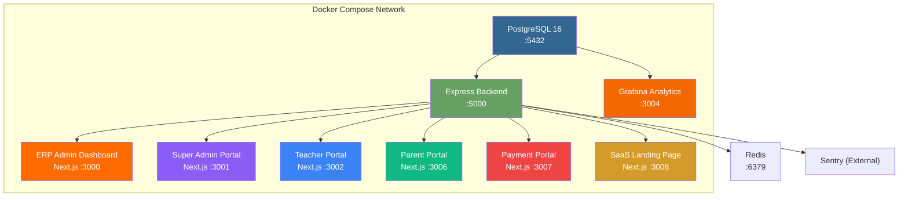
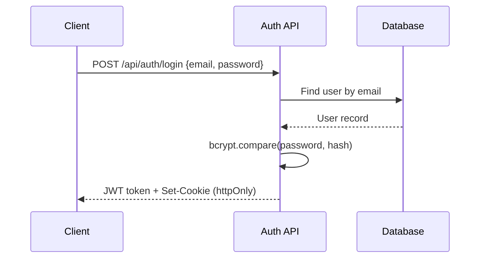

# SSVM College Square — Full Platform Documentation

> **Note**: This document was last reconciled against source code on June 17, 2026. Any future discrepancy should be resolved in favor of the code, and this note updated.
> **Version**: 3.2.0 | **Last Updated**: June 17, 2026  
> **Base URL**: `http://localhost:5000` (Backend API)  
> **Stack**: Node.js / Express / Prisma / PostgreSQL / Next.js

---

## Table of Contents

1. [System Architecture](#1-system-architecture)
2. [Authentication & Authorization](#2-authentication--authorization)
3. [Database Schema (ERD)](#3-database-schema-erd)
4. [Backend API Reference](#4-backend-api-reference)
5. [Frontend Application Structure](#5-frontend-application-structure)
6. [Environment Configuration](#6-environment-configuration)

---

## 1. System Architecture



### Service Map

| Service | Container | Port | Technology | Purpose |
|---|---|---|---|---|
| **Database** | `ssvm-database` | `5432` | PostgreSQL 16 Alpine | Primary data store |
| **Backend API** | `ssvm-backend` | `5000` | Express + Prisma + TypeScript | REST API server |
| **ERP Admin** | `ssvm-erp-admin` | `3000` | Next.js 16 | School admin dashboard |
| **Super Admin** | `ssvm-super-admin` | `3001` | Next.js 16 | Platform-wide management |
| **Teacher Portal** | `ssvm-teacher-portal` | `3002` | Next.js 16 | Teacher-facing portal |
| **Parent Portal** | `ssvm-parent-portal` | `3006` | Next.js 16 | Parent and student dashboard |
| **Payment Portal** | `ssvm-payment-portal` | `3007` | Next.js 16 | Dedicated student fee payment portal |
| **SaaS Landing** | `ssvm-saas-frontend` | `3008` | Next.js 16 | Public Greyscales registration & marketing |
| **Grafana** | `ssvm-grafana` | `3004` | Grafana Enterprise | Analytics & monitoring |
| **Redis Cache** | `ssvm-redis` | `6379` | Redis 7 Alpine | Rate limits, Caching, BullMQ |
| **Sentry** | `External` | `-` | @sentry/node | Error tracking & profiling |

### Backend Directory Structure

```
ssvm-backend/
├── prisma/
│   ├── schema.prisma          # 202 models, 15 enums, ~3800 lines
│   └── migrations/
│       └── 20260612100205_add_phase_10a_features/
├── src/
│   ├── index.ts               # Express app entry point (30 route mounts)
│   ├── config/
│   │   └── env.ts             # Environment validation
│   ├── lib/
│   │   ├── prisma.ts          # Prisma client singleton
│   │   └── logger.ts          # Pino logger
│   ├── middleware/
│   │   ├── auth.ts            # JWT + RBAC middleware
│   │   ├── errorHandler.ts    # Global error handler
│   │   ├── tenant.ts          # Multi-tenant school scoping
│   │   └── validate.ts        # Zod schema validation
│   ├── validators/
│   │   └── schemas.ts         # Zod validation schemas
│   └── routes/                # 55 route files
│       ├── 2fa.ts               # Auto-mapped to /api/v1/2fa
│       ├── academic.ts          # Auto-mapped to /api/v1/academic
│       ├── activity.ts          # Auto-mapped to /api/v1/activity
│       ├── admissions.ts        # Auto-mapped to /api/v1/admissions
│       ├── alumni.ts            # Auto-mapped to /api/v1/alumni
│       ├── assets.ts            # Auto-mapped to /api/v1/assets
│       ├── assignments.ts       # Auto-mapped to /api/v1/assignments
│       ├── attendance.ts        # Auto-mapped to /api/v1/attendance
│       ├── auth.ts              # Auto-mapped to /api/v1/auth
│       ├── backups.ts           # Auto-mapped to /api/v1/backups
│       ├── branches.ts          # Auto-mapped to /api/v1/branches
│       ├── bulk.ts              # Auto-mapped to /api/v1/bulk
│       ├── certificates.ts      # Auto-mapped to /api/v1/certificates
│       ├── cms.ts               # Auto-mapped to /api/v1/cms
│       ├── communications.ts    # Auto-mapped to /api/v1/communications
│       ├── crm.ts               # Auto-mapped to /api/v1/crm
│       ├── discipline.ts        # Auto-mapped to /api/v1/discipline
│       ├── documents.ts         # Auto-mapped to /api/v1/documents
│       ├── events.ts            # Auto-mapped to /api/v1/events
│       ├── exams.ts             # Auto-mapped to /api/v1/exams
│       ├── finance-governance.ts # Auto-mapped to /api/v1/finance-governance
│       ├── finance-reconciliation.ts # Auto-mapped to /api/v1/finance-reconciliation
│       ├── finance.ts           # Auto-mapped to /api/v1/finance
│       ├── gallery.ts           # Auto-mapped to /api/v1/gallery
│       ├── guardians.ts         # Auto-mapped to /api/v1/guardians
│       ├── health.ts            # Auto-mapped to /api/v1/health
│       ├── hr.ts                # Auto-mapped to /api/v1/hr
│       ├── inventory.ts         # Auto-mapped to /api/v1/inventory
│       ├── invoices.ts          # Auto-mapped to /api/v1/invoices
│       ├── library.ts           # Auto-mapped to /api/v1/library
│       ├── messages.ts          # Auto-mapped to /api/v1/messages
│       ├── mobile.ts            # Auto-mapped to /api/v1/mobile
│       ├── notices.ts           # Auto-mapped to /api/v1/notices
│       ├── notifications.ts     # Auto-mapped to /api/v1/notifications
│       ├── payments.ts          # Auto-mapped to /api/v1/payments
│       ├── preferences.ts       # Auto-mapped to /api/v1/preferences
│       ├── procurement.ts       # Auto-mapped to /api/v1/procurement
│       ├── reception.ts         # Auto-mapped to /api/v1/reception
│       ├── reports.ts           # Auto-mapped to /api/v1/reports
│       ├── results.ts           # Auto-mapped to /api/v1/results
│       ├── saas.ts              # Auto-mapped to /api/v1/saas
│       ├── scholarships.ts      # Auto-mapped to /api/v1/scholarships
│       ├── schools.ts           # Auto-mapped to /api/v1/schools
│       ├── search.ts            # Auto-mapped to /api/v1/search
│       ├── security.ts          # Auto-mapped to /api/v1/security
│       ├── sessions.ts          # Auto-mapped to /api/v1/sessions
│       ├── sse.ts               # Auto-mapped to /api/v1/sse
│       ├── stats.ts             # Auto-mapped to /api/v1/stats
│       ├── storage.ts           # Auto-mapped to /api/v1/storage
│       ├── students.ts          # Auto-mapped to /api/v1/students
│       ├── subscriptions.ts     # Auto-mapped to /api/v1/subscriptions
│       ├── teachers.ts          # Auto-mapped to /api/v1/teachers
│       ├── timetable.ts         # Auto-mapped to /api/v1/timetable
│       ├── users.ts             # Auto-mapped to /api/v1/users
│       └── webhooks.ts          # Auto-mapped to /api/v1/webhooks
├── Dockerfile
└── entrypoint.sh
```

---

## 2. Authentication & Authorization

### Authentication Flow



### Login Types

| Login Type | Endpoint | Credentials |
|---|---|---|
| **Staff/Admin** | `POST /api/auth/login` | email + password |
| **Student** | `POST /api/auth/student/login` | admissionNo + password |
| **Alumni** | `POST /api/auth/alumni/register` | Self-registration (public) |

### JWT Payload

```json
{
  "id": "cuid_user_id",
  "email": "admin@ssvm.edu.in",
  "role": "ERP_ADMIN",
  "name": "Admin User",
  "schoolId": "cuid_string"
}
```

### Role-Based Access Control (RBAC) Matrix

| Role | Scope | Permissions |
|---|---|---|
| `SUPER_ADMIN` | Platform-wide | Full access to all schools, users, and configurations |
| `ERP_ADMIN` | Single school | Manage students, teachers, fees, exams, notices within their school |
| `WEBSITE_ADMIN` | Single school | Manage CMS, gallery, testimonials, notices, events |
| `TEACHER` | Own school | View students, mark attendance, manage results, view timetable |
| `ACCOUNTANT` | Single school | Fee management and financial reports |
| `HR` | Single school | Salary and leave management |
| `LIBRARIAN` | Single school | Library management (future module) |
| `RECEPTIONIST` | Single school | Front-desk operations |
| `ASSET_MANAGER` | Single school | Inventory management, asset tracking, stock monitoring, procurement |
| `PARENT` | Own children | View own children's attendance, results, fees |
| `ALUMNI` | Self | View/update own alumni profile |
| `STUDENT` | Self | View own results, attendance, assignments |

### Middleware Stack

| Middleware | Function | Description |
|---|---|---|
| `authenticate` | Required auth | Verifies JWT, attaches `req.user` |
| `optionalAuth` | Optional auth | Attaches user if token present, continues otherwise |
| `requireRole(...roles)` | Role guard | Restricts to specific roles |
| `requireTeacherOrAdmin()` | Teacher+ | `SUPER_ADMIN`, `ERP_ADMIN`, `TEACHER` |
| `requireFinanceAdmin()` | Finance Domain | `SUPER_ADMIN`, `ERP_ADMIN`, `ACCOUNTANT` |
| `requireContentAdmin()` | Content Domain | `SUPER_ADMIN`, `ERP_ADMIN`, `WEBSITE_ADMIN` |
| `requireHRAdmin()` | HR Domain | `SUPER_ADMIN`, `ERP_ADMIN`, `HR` |
| `requireAcademicAdmin()` | Academic Domain | `SUPER_ADMIN`, `ERP_ADMIN` |
| `requireLibraryAdmin()` | Library Domain | `SUPER_ADMIN`, `ERP_ADMIN`, `LIBRARIAN` |
| `requireAdmissionsAdmin()` | Admissions Domain | `SUPER_ADMIN`, `ERP_ADMIN`, `RECEPTIONIST` |
| `requireCommunicationsAdmin()` | Comm Domain | `SUPER_ADMIN`, `ERP_ADMIN`, `RECEPTIONIST`, `HR` |
| `requireOperationsAdmin()` | Operations Domain | `SUPER_ADMIN`, `ERP_ADMIN` |
| `requireSuperAdmin()` | Platform admin | `SUPER_ADMIN` only |
| `requireSchoolAccess()` | Tenant guard | Ensures users can only access their own school's data |
| `schoolContextMiddleware` | Tenant Isolation | Injects `app.current_school_id` into Prisma via AsyncLocalStorage |
| `bruteForceCheck` | Rate Limiting | Progressive delay (up to 1hr lockout) for failed auth attempts |
| `securityHeaders` | WAF/Sec Headers | Hardens response headers (HSTS, NoSniff, Frame-Options) |
| `rejectClosedPeriod` | Financial Guard | Blocks mutations on records within a CLOSED financial period |
| `metricsMiddleware` | SLO/SLI | Tracks request duration, active connections, and per-tenant usage |

---

## 3. Database Schema (ERD)

### Core Entity Relationship Diagram

```mermaid
erDiagram
    School ||--o{ Branch : has
    School ||--o| Subscription : has
    School ||--o{ AcademicSession : has
    School ||--o{ Department : has
    School ||--o{ Class : has
    School ||--o{ Student : has
    School ||--o{ Teacher : has
    School ||--o{ Subject : has
    School ||--o{ Invoice : has
    School ||--o{ FeeCategory : has
    School ||--o{ FeeStructure : has
    School ||--o{ FineRule : has
    School ||--o{ Exam : has
    School ||--o{ Timetable : has
    School ||--o{ Admission : has
    School ||--o{ Notice : has
    School ||--o{ Event : has
    School ||--o{ Notification : has
    School ||--o{ Salary : has
    School ||--o{ Attendance : has
    School ||--o{ Assignment : has
    School ||--o{ AuditLog : has
    School ||--o{ ActivityLog : has
    School ||--o{ TeacherSubjectAssignment : has
    School ||--o{ NotificationTemplate : has
    School ||--o{ Scholarship : has
    School ||--o| OnboardingProgress : has

    AcademicSession ||--o{ Class : contains
    Class ||--o{ Section : contains
    Section ||--o{ Student : enrolls
    Section ||--o{ Timetable : has
    Section ||--o{ Attendance : tracks
    Section ||--o{ ClassTeacher : assigned
    Section ||--o{ TeacherSubjectAssignment : maps

    User ||--o| Teacher : is
    User ||--o| Alumni : is
    User ||--o| Guardian : is
    User ||--o{ Notice : authors
    User ||--o{ Event : creates
    User ||--o{ AuditLog : generates

    Department ||--o{ Teacher : contains

    Teacher ||--o{ TeacherAttendance : has
    Teacher ||--o{ LeaveRequest : submits
    Teacher ||--o{ Salary : receives
    Teacher ||--o{ Attendance : marks
    Teacher ||--o{ ClassTeacher : assigned
    Teacher ||--o{ TeacherSubjectAssignment : maps
    Teacher ||--o{ Assignment : creates

    Guardian ||--o{ Student : parents
    Student ||--o{ Attendance : has
    Student ||--o{ StudentMark : receives
    Student ||--o{ Invoice : has
    Student ||--o{ AssignmentSubmission : submits
    Student ||--o{ StudentTimeline : has
    Student ||--o{ Scholarship : receives

    Subject ||--o{ ClassSubject : linked
    Subject ||--o{ TeacherSubject : linked
    Subject ||--o{ ExamSubject : tested
    Subject ||--o{ TeacherSubjectAssignment : assigned

    TeacherSubjectAssignment ||--o{ TimetableSlot : scheduled

    Exam ||--o{ ExamSubject : contains
    ExamSubject ||--o{ StudentMark : records

    Timetable ||--o{ TimetableSlot : contains

    Invoice ||--o{ PaymentTransaction : has
    FeeCategory ||--o{ FeeStructure : defines

    Assignment ||--o{ AssignmentSubmission : receives
    Assignment ||--o{ AssignmentAttachment : has

    Admission ||--o{ AdmissionLog : tracks
    Alumni ||--o{ Contribution : makes

    Subscription ||--o{ SubscriptionPayment : has
```

### Enums (15 Enums)

| Enum | Values |
|---|---|
| `Role` | `SUPER_ADMIN`, `ERP_ADMIN`, `WEBSITE_ADMIN`, `TEACHER`, `ACCOUNTANT`, `HR`, `LIBRARIAN`, `RECEPTIONIST`, `ASSET_MANAGER`, `PARENT`, `ALUMNI`, `STUDENT` |
| `DocumentOwnerType` | `STUDENT`, `TEACHER`, `ADMISSION`, `STAFF`, `SCHOOL` |
| `DocumentCategory` | `AADHAAR`, `BIRTH_CERTIFICATE`, `MARKSHEET`, `TC`, `ADMISSION_FORM`, `PASSPORT`, `OTHER` |
| `ActivityType` | `ADMISSION`, `PAYMENT`, `RESULT`, `ATTENDANCE`, `TEACHER`, `NOTICE` |
| `NoticeStatus` | `DRAFT`, `PUBLISHED`, `ARCHIVED` |
| `EventStatus` | `PLANNING`, `UPCOMING`, `COMPLETED`, `CANCELLED` |
| `InvoiceStatus` | `PAID`, `PENDING`, `OVERDUE`, `PARTIAL`, `UNPAID` |
| `FeeType` | `ADMISSION`, `READMISSION`, `MONTHLY`, `EXAM`, `TRANSPORT`, `HOSTEL`, `MISCELLANEOUS` |
| `AttendanceStatus` | `PRESENT`, `ABSENT`, `LATE`, `HOLIDAY` |
| `AssignmentStatus` | `PENDING`, `SUBMITTED`, `GRADED`, `LATE_SUBMITTED` |
| `LeaveStatus` | `PENDING`, `APPROVED`, `REJECTED` |
| `AdmissionStatus` | `PENDING`, `UNDER_REVIEW`, `DOCUMENTS_VERIFIED`, `INTERVIEW`, `APPROVED`, `REJECTED`, `ENROLLED` |
| `NotificationType` | `SMS`, `EMAIL`, `WHATSAPP` |
| `NotificationStatus` | `QUEUED`, `SENT`, `FAILED` |
| `SalaryStatus` | `PENDING`, `PAID`, `HOLD` |

### Model Summary (202 Models)

| # | Model | Table | Key Fields | Relations |
|---|---|---|---|---|
| 1 | `School` | `schools` | id, name, code, status | → SchoolStatus, TenantState |
| 2 | `Branch` | `branches` | id, schoolId, name | → School |
| 3 | `Subscription` | `subscriptions` | id, schoolId, status | → SubscriptionPlanConfig, School |
| 4 | `SubscriptionPlanConfig` | `subscription_plan_configs` | id, name | - |
| 5 | `SubscriptionPayment` | `subscription_payments` | id, schoolId | → School, Subscription |
| 6 | `Permission` | `permissions` | id, name | - |
| 7 | `RolePermission` | `role_permissions` | id | → Role, Permission |
| 8 | `User` | `users` | id, email, name, schoolId | → Role |
| 9 | `RefreshToken` | `refresh_tokens` | id, token | → User |
| 10 | `OTP` | `otps` | id | - |
| 11 | `AcademicSession` | `academic_sessions` | id, schoolId, name | → School |
| 12 | `Class` | `classes` | id, schoolId, name | → School, AcademicSession |
| 13 | `Section` | `sections` | id, name | → Class |
| 14 | `ClassTeacher` | `class_teachers` | id | → Section, Teacher |
| 15 | `Department` | `departments` | id, schoolId, name | → School |
| 16 | `Teacher` | `teachers` | id, userId, schoolId | → School, User |
| 17 | `Guardian` | `guardians` | id, userId, schoolId | - |
| 18 | `Student` | `students` | id, schoolId, admissionNo, name, userId | → School |
| 19 | `StudentTimeline` | `student_timeline` | id, title, type | → Student |
| 20 | `Alumni` | `alumni` | id, userId | → User |
| 21 | `Attendance` | `attendance` | id, schoolId, status | → AttendanceStatus, School, Student |
| 22 | `TeacherAttendance` | `teacher_attendance` | id, status | → AttendanceStatus, Teacher |
| 23 | `LeaveRequest` | `leave_requests` | id, status | → LeaveStatus, Teacher |
| 24 | `Subject` | `subjects` | id, schoolId, name | → School |
| 25 | `ClassSubject` | `class_subjects` | id | → Class, Subject |
| 26 | `TeacherSubject` | `teacher_subjects` | id | → Subject, Teacher |
| 27 | `Timetable` | `timetables` | id, schoolId | → School, Section |
| 28 | `TimetableSlot` | `timetable_slots` | id | → TeacherSubjectAssignment, Timetable |
| 29 | `Exam` | `exams` | id, schoolId, name | → Class, School |
| 30 | `ExamSubject` | `exam_subjects` | id | → Exam, Subject |
| 31 | `StudentMark` | `student_marks` | id | → ExamSubject, Student |
| 32 | `Notice` | `notices` | id, schoolId, title, status | → NoticeStatus, User |
| 33 | `Event` | `events` | id, schoolId, title, status | → EventStatus, User |
| 34 | `FeeCategory` | `fee_categories` | id, schoolId, name | → School |
| 35 | `FeeStructure` | `fee_structures` | id, schoolId | → FeeCategory, School |
| 36 | `FineRule` | `fine_rules` | id, schoolId | → School |
| 37 | `Invoice` | `invoices` | id, schoolId, type, status | → FeeType, InvoiceStatus, School |
| 38 | `Assignment` | `assignments` | id, schoolId, title | → School, Subject |
| 39 | `AssignmentAttachment` | `assignment_attachments` | id | → Assignment |
| 40 | `AssignmentSubmission` | `assignment_submissions` | id, status | → AssignmentStatus, Assignment, Student |
| 41 | `StudyMaterial` | `study_materials` | id, schoolId, title | → School |
| 42 | `Admission` | `admissions` | id, schoolId, status | → AdmissionStatus, School |
| 43 | `AdmissionLog` | `admission_logs` | id, status | → AdmissionStatus, Admission |
| 44 | `Salary` | `salaries` | id, schoolId, status | → SalaryStatus, School, Teacher |
| 45 | `Notification` | `notifications` | id, schoolId, type, status | → NotificationType, NotificationStatus |
| 46 | `NotificationDelivery` | `notification_deliveries` | id, schoolId, status | → NotificationChannel, NotificationStatus, Notification |
| 47 | `MessageTemplate` | `message_templates` | id, schoolId, name | → NotificationType |
| 48 | `GalleryImage` | `gallery_images` | id, schoolId, title | - |
| 49 | `Contribution` | `contributions` | id | → Alumni |
| 50 | `SiteContent` | `site_content` | id, schoolId, type | - |
| 51 | `Testimonial` | `testimonials` | id, schoolId, name | - |
| 52 | `PaymentTransaction` | `payment_transactions` | id, transactionId, status, schoolId, gatewayPaymentId | → Invoice |
| 53 | `RazorpayReconciliation` | `razorpay_reconciliations` | id, schoolId, settlementId, status | → ReconciliationStatus, School |
| 54 | `IdempotencyRecord` | `idempotency_records` | id, key, status | - |
| 55 | `ReportTemplate` | `report_templates` | id, schoolId, name, type | → School |
| 56 | `DocumentRepository` | `document_repository` | id, schoolId, name | → School |
| 57 | `CommunicationTemplate` | `communication_templates` | id, schoolId, name | → School |
| 58 | `CommunicationLog` | `communication_logs` | id, schoolId, type, status | → School |
| 59 | `AuditLog` | `audit_logs` | id, schoolId | - |
| 60 | `TeacherSubjectAssignment` | `teacher_subject_assignments` | id, schoolId | → AcademicSession, School, Section |
| 61 | `OnboardingProgress` | `onboarding_progress` | id, schoolId | → School |
| 62 | `Document` | `documents` | id, schoolId, title | → DocumentOwnerType, DocumentCategory, School |
| 63 | `ActivityLog` | `activity_logs` | id, schoolId, type, title | → ActivityType, School |
| 64 | `Scholarship` | `scholarships` | id, schoolId, name, status | → ScholarshipStatus, School, Student |
| 65 | `NotificationTemplate` | `notification_templates` | id, schoolId, name, type | → NotificationType, School |
| 66 | `Book` | `books` | id, schoolId, title | → School |
| 67 | `BookIssue` | `book_issues` | id, schoolId, status | → Book, School |
| 68 | `SystemBackup` | `system_backups` | id, type, status | - |
| 69 | `BulkJob` | `bulk_jobs` | id, schoolId, type, status | → School |
| 70 | `Template` | `unified_templates` | id, schoolId, name | → School |
| 71 | `UserSession` | `user_sessions` | id, sessionId | → User |
| 72 | `AdmissionEnquiry` | `admission_enquiries` | id, schoolId, status | → School |
| 73 | `PipelineStage` | `PipelineStage` | id, schoolId, name | - |
| 74 | `LeadInteraction` | `LeadInteraction` | id, type | → AdmissionEnquiry |
| 75 | `MarketingCampaign` | `MarketingCampaign` | id, schoolId, name | - |
| 76 | `VisitorLog` | `visitor_logs` | id, schoolId | → School |
| 77 | `ReceptionComplaint` | `reception_complaints` | id, schoolId, name, status | → ComplaintStatus, School |
| 78 | `ReceptionCallLog` | `reception_call_logs` | id, schoolId | → School |
| 79 | `WebhookEndpoint` | `webhook_endpoints` | id, schoolId | - |
| 80 | `ScheduledJob` | `scheduled_jobs` | id, name, status | - |
| 81 | `SupportTicket` | `support_tickets` | id, schoolId, status | → School, User |
| 82 | `SupportMessage` | `support_messages` | id | → User, SupportTicket |
| 83 | `CertificateTemplate` | `certificate_templates` | id, schoolId, name | → School |
| 84 | `IssuedCertificate` | `issued_certificates` | id, qrHash, status | → User, Student, CertificateTemplate |
| 85 | `MessageThread` | `message_threads` | id, schoolId | → School |
| 86 | `MessageParticipant` | `message_participants` | id | → MessageThread, User |
| 87 | `Message` | `messages` | id | → User, MessageThread |
| 88 | `MessageAttachment` | `message_attachments` | id | → Message |
| 89 | `UserDevice` | `user_devices` | id, deviceToken | → User |
| 90 | `AppVersion` | `app_versions` | id, platform | - |
| 91 | `TransportVehicle` | `transport_vehicles` | id, schoolId, registrationNumber, status | → School |
| 92 | `TransportRoute` | `transport_routes` | id, schoolId, name | → School |
| 93 | `TransportStop` | `transport_stops` | id, name | → TransportRoute |
| 94 | `TransportAllocation` | `transport_allocations` | id, schoolId, status | → School, TransportStop, Student |
| 95 | `DataClassification` | `data_classifications` | id, schoolId | → School |
| 96 | `UserConsent` | `user_consents` | id, schoolId | → School, User |
| 97 | `FinancialPeriod` | `financial_periods` | id, schoolId, name, status | → School |
| 98 | `ArchiveJobLog` | `archive_job_logs` | id, schoolId, status | → School |
| 99 | `HostelRoom` | `hostel_rooms` | id, schoolId, status | → School |
| 100 | `HostelAllocation` | `hostel_allocations` | id, schoolId, status | → HostelRoom, School, Student |
| 101 | `HelpdeskTicket` | `helpdesk_tickets` | id, schoolId, title, status | → User, School |
| 102 | `MessageReadReceipt` | `message_read_receipts` | id | → Message |
| 103 | `FeatureFlag` | `feature_flags` | id, code, name | - |
| 104 | `SchoolFeature` | `school_features` | id, schoolId | → FeatureFlag, School |
| 105 | `SchoolSettings` | `school_settings` | id, schoolId | → School |
| 106 | `BrandSettings` | `brand_settings` | id, schoolId, customDomain | → School |
| 107 | `SchoolRegistrationRequest` | `school_registration_requests` | id, email, status | - |
| 108 | `StorageObject` | `storage_objects` | id, key, schoolId | → School, User |
| 109 | `AssetCategory` | `asset_categories` | id, schoolId, name | → School |
| 110 | `Vendor` | `vendors` | id, schoolId, name | → School |
| 111 | `Asset` | `assets` | id, schoolId, name, status | → AssetCondition, AssetCategory, School |
| 112 | `AssetAssignment` | `asset_assignments` | id | → Asset, User, User |
| 113 | `AssetTransfer` | `asset_transfers` | id | → Asset, User |
| 114 | `AssetDepreciation` | `asset_depreciations` | id | → Asset |
| 115 | `MaintenanceRecord` | `maintenance_records` | id, type, status | → Asset |
| 116 | `PurchaseOrder` | `purchase_orders` | id, schoolId, poNumber, status | → User, School, Vendor |
| 117 | `PurchaseOrderItem` | `purchase_order_items` | id, status | → PurchaseOrder |
| 118 | `FailedJob` | `failed_jobs` | id, status | - |
| 119 | `SystemLog` | `system_logs` | id, schoolId | - |
| 120 | `Contract` | `contracts` | id, schoolId, status | → School |
| 121 | `UsageMetric` | `usage_metrics` | id, schoolId | → BigInt, School |
| 122 | `CustomDomain` | `custom_domains` | id, schoolId, domain, status | → School |
| 123 | `ConsentRecord` | `consent_records` | id, schoolId, type | → Guardian, School |
| 124 | `NotificationPreference` | `notification_preferences` | id, type | → User |
| 125 | `SchoolSettingsHistory` | `school_settings_history` | id, schoolId | → User, School |
| 126 | `SchoolArchive` | `school_archives` | id, schoolId, status | → User, School |
| 127 | `LegalHold` | `legal_holds` | id, schoolId, status | → User, School |
| 128 | `AccountingPeriod` | `AccountingPeriod` | id, schoolId, name, status | → AccountingPeriodStatus, FiscalYear, School |
| 129 | `BankReconciliation` | `BankReconciliation` | id, schoolId | → Decimal, Decimal, LedgerAccount |
| 130 | `Budget` | `Budget` | id, schoolId, name | → School |
| 131 | `BudgetLine` | `BudgetLine` | id | → Decimal, LedgerAccount, Budget |
| 132 | `ConsolidationJournal` | `ConsolidationJournal` | id | → SchoolGroup |
| 133 | `Currency` | `Currency` | code, name | - |
| 134 | `DailyRevenueProjection` | `DailyRevenueProjection` | id, schoolId | → School |
| 135 | `DeferredRevenueSchedule` | `DeferredRevenueSchedule` | id, schoolId, invoiceId, status | → Invoice, School |
| 136 | `DocumentVersion` | `DocumentVersion` | id | → DocumentRepository |
| 137 | `DomainEvent` | `DomainEvent` | id, schoolId | → SystemDomainEventType |
| 138 | `FederatedUser` | `FederatedUser` | id | → IdentityProvider, User |
| 139 | `FinancialApprovalPolicy` | `FinancialApprovalPolicy` | id, schoolId | → Decimal, Decimal, School |
| 140 | `FinancialAudit` | `FinancialAudit` | id, schoolId | → FinancialEntityType, FinancialAuditAction, School |
| 141 | `FinancialClose` | `FinancialClose` | id, schoolId | → AccountingPeriod, School |
| 142 | `FinancialDimension` | `FinancialDimension` | id, schoolId, name | → School |
| 143 | `FinancialDimensionValue` | `FinancialDimensionValue` | id | → FinancialDimension |
| 144 | `FinancialReportCache` | `FinancialReportCache` | id, schoolId | → School |
| 145 | `FiscalYear` | `FiscalYear` | id, schoolId, name, status | → FiscalYearStatus, School |
| 146 | `IdentityProvider` | `IdentityProvider` | id, name, type | - |
| 147 | `InterCompanyTransaction` | `InterCompanyTransaction` | id, type, status, ledgerTxIdFrom, ledgerTxIdTo | → School, School |
| 148 | `JournalTemplate` | `JournalTemplate` | id, schoolId, name | → School |
| 149 | `JournalTemplateLine` | `JournalTemplateLine` | id | → LedgerAccount, JournalTemplate |
| 150 | `LedgerAccount` | `LedgerAccount` | id, schoolId, name, type | → LedgerCategory, LedgerAccountType, School |
| 151 | `LedgerEntry` | `LedgerEntry` | id | → Decimal, Decimal, LedgerAccount |
| 152 | `LedgerEvent` | `LedgerEvent` | id, schoolId | → LedgerDomainEvent, School |
| 153 | `LedgerIntegrityReport` | `LedgerIntegrityReport` | id, schoolId | → School |
| 154 | `LedgerMerkleRoot` | `LedgerMerkleRoot` | id, schoolId | → School |
| 155 | `LedgerSnapshot` | `LedgerSnapshot` | id, schoolId | → Decimal, LedgerAccount, School |
| 156 | `LedgerTransaction` | `LedgerTransaction` | id, schoolId, status, idempotencyKey | → LedgerReferenceType, LedgerSource, LedgerStatus |
| 157 | `MasterDataRegistry` | `MasterDataRegistry` | id, authoritativeId | - |
| 158 | `MasterRecordAlias` | `MasterRecordAlias` | id | → MasterDataRegistry |
| 159 | `MasterRecordMerge` | `MasterRecordMerge` | id | → MasterDataRegistry |
| 160 | `OutboxMessage` | `OutboxMessage` | id, domainEventId, status | → OutboxStatus, DomainEvent |
| 161 | `PolicyDefinition` | `PolicyDefinition` | id, schoolId, name | → School |
| 162 | `PolicyEvaluationLog` | `PolicyEvaluationLog` | id | → PolicyVersion |
| 163 | `PolicyVersion` | `PolicyVersion` | id | → PolicyDefinition |
| 164 | `PostingRule` | `PostingRule` | id, schoolId | → School |
| 165 | `PostingRuleLine` | `PostingRuleLine` | id | → LedgerAccount, PostingRule |
| 166 | `RevenueRecognitionEntry` | `RevenueRecognitionEntry` | id, ledgerTxId | → DeferredRevenueSchedule |
| 167 | `SSOConfiguration` | `SSOConfiguration` | id, schoolId | → IdentityProvider, School |
| 168 | `SchoolGroup` | `SchoolGroup` | id, name | - |
| 169 | `SequenceCounter` | `SequenceCounter` | id, schoolId | → School |
| 170 | `StudentFinancialProjection` | `StudentFinancialProjection` | id, schoolId, studentId | → School, Student |
| 171 | `WorkflowDefinition` | `WorkflowDefinition` | id, schoolId, name | → School |
| 172 | `WorkflowInstance` | `WorkflowInstance` | id, status | → WorkflowStatus, WorkflowDefinition |
| 173 | `WorkflowNode` | `WorkflowNode` | id, name, type | → WorkflowNodeType, WorkflowDefinition |
| 174 | `WorkflowTask` | `WorkflowTask` | id, status | → TaskStatus, WorkflowInstance, WorkflowNode |
| 175 | `WorkflowTransition` | `WorkflowTransition` | id | → WorkflowNode, WorkflowNode |
| 176 | `auth_events` | `auth_events` | id, schoolId | → AuthEventType |
| 177 | `IntegrationApp` | `IntegrationApp` | id, name, clientId | - |
| 178 | `SchoolIntegration` | `SchoolIntegration` | id, schoolId, status | → School |
| 179 | `WebhookDelivery` | `WebhookDelivery` | id, schoolId, status | → School |
| 180 | `PermissionGroup` | `permission_groups` | id, schoolId, name | - |
| 181 | `UserDelegation` | `user_delegations` | id, schoolId | → User, User, School |
| 182 | `MasterCountry` | `mdm_countries` | id, code, name | - |
| 183 | `MasterState` | `mdm_states` | id, code, name | → MasterCountry |
| 184 | `MasterCity` | `mdm_cities` | id, name | → MasterState |
| 185 | `MasterReligion` | `mdm_religions` | id, name | - |
| 186 | `MasterCategory` | `mdm_categories` | id, name | - |
| 187 | `MasterSubject` | `mdm_subjects` | id, code, name | - |
| 188 | `MasterDepartment` | `mdm_departments` | id, code, name | - |
| 189 | `AccessReview` | `access_reviews` | id, schoolId, status | → AccessReviewStatus, User, School |
| 190 | `IncidentReport` | `incident_reports` | id, schoolId, type, title, status | → User, School, Student |
| 191 | `BackupValidation` | `backup_validations` | id, status | - |
| 192 | `PurchaseRequest` | `PurchaseRequest` | id, schoolId, requestNumber, status | → PRStatus |
| 193 | `PurchaseRequestItem` | `PurchaseRequestItem` | id | → PurchaseRequest |
| 194 | `GoodsReceipt` | `GoodsReceipt` | id, schoolId, grNumber | → PurchaseOrder |
| 195 | `VendorInvoice` | `VendorInvoice` | id, schoolId, status | → Vendor |
| 196 | `InventoryLocation` | `InventoryLocation` | id, schoolId, name | - |
| 197 | `InventoryItem` | `InventoryItem` | id, schoolId, sku, name | - |
| 198 | `InventoryStock` | `InventoryStock` | id, schoolId | → InventoryItem, InventoryLocation |
| 199 | `StockLedger` | `StockLedger` | id, schoolId | → InventoryMovementType |
| 200 | `DataRetentionPolicy` | `DataRetentionPolicy` | id, schoolId | - |
| 201 | `CustomWorkflow` | `CustomWorkflow` | id, schoolId, name | - |
| 202 | `WorkflowStep` | `WorkflowStep` | id | → CustomWorkflow |

---

## Known Gaps

- Frontend hook `useAnalytics` points to `/api/stats/overview`, but backend route does not exist (likely should point to `/api/stats/detailed`) — tracked for Phase 2.
- **Note on Documented vs Real Routes**: My ground-truth audit confirmed `useTeacherAttendance`, `useResults`, and `useFinanceStats` all map to real backend endpoints. The auth scheme correctly uses cookies as primary transport, messaging uses the `/{threadId}` shape, and notifications uses the 8-endpoint setup. The bulk import endpoints are real and mapped below. No RLS type casting bugs were found because Prisma uses dynamic injection rather than PostgreSQL contexts for school isolation.

## 4. Backend API Reference

> **Standard Response Format**:
> ```json
> { "success": true|false, "data": {...}, "error": "message" }
> ```
> 
> **API Versioning (Phase 12A.1)**:
> All API routes are mounted under the `/api/v1/*` namespace globally.

### Endpoints Map (263 Endpoints across 55 Route Modules)

This section auto-documents the 263 distinct API endpoints currently live in the system, extracted directly from the routing layer via the OpenAPI 3.1.0 generator.

#### Module: `2fa`
| Method | Path | Summary |
|---|---|---|
| **POST** | `/api/v1/2fa/disable` | POST /api/v1/2fa/disable |
| **POST** | `/api/v1/2fa/setup` | POST /api/v1/2fa/setup |
| **POST** | `/api/v1/2fa/validate` | POST /api/v1/2fa/validate |
| **POST** | `/api/v1/2fa/verify-setup` | POST /api/v1/2fa/verify-setup |

#### Module: `academic`
| Method | Path | Summary |
|---|---|---|
| **POST** | `/api/v1/academic/class-teachers` | POST /api/v1/academic/class-teachers |
| **DELETE** | `/api/v1/academic/class-teachers/{id}` | DELETE /api/v1/academic/class-teachers/{id} |
| **GET** | `/api/v1/academic/class-teachers/{sectionId}` | GET /api/v1/academic/class-teachers/{sectionId} |
| **GET** | `/api/v1/academic/classes` | GET /api/v1/academic/classes |
| **POST** | `/api/v1/academic/classes` | POST /api/v1/academic/classes |
| **POST** | `/api/v1/academic/classes/bulk` | POST /api/v1/academic/classes/bulk |
| **GET** | `/api/v1/academic/sections` | GET /api/v1/academic/sections |
| **POST** | `/api/v1/academic/sections` | POST /api/v1/academic/sections |
| **POST** | `/api/v1/academic/sections/bulk` | POST /api/v1/academic/sections/bulk |
| **GET** | `/api/v1/academic/sessions` | GET /api/v1/academic/sessions |
| **POST** | `/api/v1/academic/sessions` | POST /api/v1/academic/sessions |

#### Module: `activity`
| Method | Path | Summary |
|---|---|---|
| **GET** | `/api/v1/activity` | GET /api/v1/activity |

#### Module: `admin`
| Method | Path | Summary |
|---|---|---|
| **POST** | `/api/v1/admin/governance-workflows/retention-policies` | Configure automated database purges |

#### Module: `admissions`
| Method | Path | Summary |
|---|---|---|
| **GET** | `/api/v1/admissions` | GET /api/v1/admissions |
| **POST** | `/api/v1/admissions/apply` | POST /api/v1/admissions/apply |
| **DELETE** | `/api/v1/admissions/{id}` | DELETE /api/v1/admissions/{id} |
| **POST** | `/api/v1/admissions/{id}/enroll` | POST /api/v1/admissions/{id}/enroll |
| **PUT** | `/api/v1/admissions/{id}/review` | PUT /api/v1/admissions/{id}/review |

#### Module: `alumni`
| Method | Path | Summary |
|---|---|---|
| **GET** | `/api/v1/alumni` | GET /api/v1/alumni |
| **PUT** | `/api/v1/alumni` | PUT /api/v1/alumni |
| **GET** | `/api/v1/alumni/contributions` | GET /api/v1/alumni/contributions |
| **POST** | `/api/v1/alumni/contributions` | POST /api/v1/alumni/contributions |

#### Module: `assets`
| Method | Path | Summary |
|---|---|---|
| **GET** | `/api/v1/assets` | GET /api/v1/assets |
| **POST** | `/api/v1/assets` | POST /api/v1/assets |
| **POST** | `/api/v1/assets/categories` | POST /api/v1/assets/categories |
| **GET** | `/api/v1/assets/categories` | GET /api/v1/assets/categories |
| **PUT** | `/api/v1/assets/categories/{id}` | PUT /api/v1/assets/categories/{id} |
| **GET** | `/api/v1/assets/stats` | GET /api/v1/assets/stats |
| **POST** | `/api/v1/assets/vendors` | POST /api/v1/assets/vendors |
| **GET** | `/api/v1/assets/vendors` | GET /api/v1/assets/vendors |
| **PUT** | `/api/v1/assets/vendors/{id}` | PUT /api/v1/assets/vendors/{id} |
| **PUT** | `/api/v1/assets/{id}` | PUT /api/v1/assets/{id} |
| **DELETE** | `/api/v1/assets/{id}` | DELETE /api/v1/assets/{id} |
| **POST** | `/api/v1/assets/{id}/assign` | POST /api/v1/assets/{id}/assign |
| **DELETE** | `/api/v1/assets/{id}/assign` | DELETE /api/v1/assets/{id}/assign |
| **GET** | `/api/v1/assets/{id}/maintenance` | GET /api/v1/assets/{id}/maintenance |
| **POST** | `/api/v1/assets/{id}/maintenance` | POST /api/v1/assets/{id}/maintenance |
| **POST** | `/api/v1/assets/{id}/transfer` | POST /api/v1/assets/{id}/transfer |

#### Module: `assignments`
| Method | Path | Summary |
|---|---|---|
| **GET** | `/api/v1/assignments` | GET /api/v1/assignments |
| **POST** | `/api/v1/assignments` | POST /api/v1/assignments |
| **GET** | `/api/v1/assignments/study-materials` | GET /api/v1/assignments/study-materials |
| **POST** | `/api/v1/assignments/submissions/{submissionId}/grade` | POST /api/v1/assignments/submissions/{submissionId}/grade |
| **POST** | `/api/v1/assignments/{id}/submit` | POST /api/v1/assignments/{id}/submit |

#### Module: `attendance`
| Method | Path | Summary |
|---|---|---|
| **GET** | `/api/v1/attendance` | GET /api/v1/attendance |
| **POST** | `/api/v1/attendance` | POST /api/v1/attendance |
| **GET** | `/api/v1/attendance/teachers` | GET /api/v1/attendance/teachers |
| **POST** | `/api/v1/attendance/teachers` | POST /api/v1/attendance/teachers |

#### Module: `auth`
| Method | Path | Summary |
|---|---|---|
| **POST** | `/api/v1/auth/alumni/register` | POST /api/v1/auth/alumni/register |
| **POST** | `/api/v1/auth/change-password` | POST /api/v1/auth/change-password |
| **GET** | `/api/v1/auth/events` | GET /api/v1/auth/events |
| **POST** | `/api/v1/auth/login` | POST /api/v1/auth/login |
| **POST** | `/api/v1/auth/logout` | POST /api/v1/auth/logout |
| **POST** | `/api/v1/auth/logout/all` | POST /api/v1/auth/logout/all |
| **GET** | `/api/v1/auth/me` | GET /api/v1/auth/me |
| **POST** | `/api/v1/auth/refresh` | POST /api/v1/auth/refresh |
| **POST** | `/api/v1/auth/register` | POST /api/v1/auth/register |
| **POST** | `/api/v1/auth/revoke-session` | POST /api/v1/auth/revoke-session |
| **GET** | `/api/v1/auth/sessions` | GET /api/v1/auth/sessions |
| **DELETE** | `/api/v1/auth/sessions/{id}` | DELETE /api/v1/auth/sessions/{id} |
| **POST** | `/api/v1/auth/student/login` | POST /api/v1/auth/student/login |

#### Module: `backups`
| Method | Path | Summary |
|---|---|---|
| **GET** | `/api/v1/backups/status` | GET /api/v1/backups/status |
| **POST** | `/api/v1/backups/trigger` | POST /api/v1/backups/trigger |
| **GET** | `/api/v1/backups/{id}/download` | GET /api/v1/backups/{id}/download |

#### Module: `branches`
| Method | Path | Summary |
|---|---|---|
| **GET** | `/api/v1/branches` | GET /api/v1/branches |
| **POST** | `/api/v1/branches` | POST /api/v1/branches |
| **PUT** | `/api/v1/branches/{id}` | PUT /api/v1/branches/{id} |
| **DELETE** | `/api/v1/branches/{id}` | DELETE /api/v1/branches/{id} |

#### Module: `bulk`
| Method | Path | Summary |
|---|---|---|
| **GET** | `/api/v1/bulk/jobs` | GET /api/v1/bulk/jobs |
| **GET** | `/api/v1/bulk/jobs/{id}` | GET /api/v1/bulk/jobs/{id} |
| **POST** | `/api/v1/bulk/upload` | POST /api/v1/bulk/upload |

#### Module: `certificates`
| Method | Path | Summary |
|---|---|---|
| **POST** | `/api/v1/certificates/issue` | POST /api/v1/certificates/issue |
| **GET** | `/api/v1/certificates/templates` | GET /api/v1/certificates/templates |
| **GET** | `/api/v1/certificates/verify/{certNo}` | GET /api/v1/certificates/verify/{certNo} |

#### Module: `cms`
| Method | Path | Summary |
|---|---|---|
| **GET** | `/api/v1/cms/analytics` | GET /api/v1/cms/analytics |
| **GET** | `/api/v1/cms/site-content` | GET /api/v1/cms/site-content |
| **PUT** | `/api/v1/cms/site-content` | PUT /api/v1/cms/site-content |
| **GET** | `/api/v1/cms/testimonials` | GET /api/v1/cms/testimonials |
| **POST** | `/api/v1/cms/testimonials` | POST /api/v1/cms/testimonials |

#### Module: `communications`
| Method | Path | Summary |
|---|---|---|
| **GET** | `/api/v1/communications/logs` | GET /api/v1/communications/logs |
| **POST** | `/api/v1/communications/send` | POST /api/v1/communications/send |
| **GET** | `/api/v1/communications/templates` | GET /api/v1/communications/templates |
| **POST** | `/api/v1/communications/templates` | POST /api/v1/communications/templates |

#### Module: `crm`
| Method | Path | Summary |
|---|---|---|
| **POST** | `/api/v1/crm/leads` | POST /api/v1/crm/leads |
| **POST** | `/api/v1/crm/leads/{id}/interactions` | POST /api/v1/crm/leads/{id}/interactions |
| **PUT** | `/api/v1/crm/leads/{id}/stage` | PUT /api/v1/crm/leads/{id}/stage |
| **GET** | `/api/v1/crm/pipeline` | GET /api/v1/crm/pipeline |

#### Module: `discipline`
| Method | Path | Summary |
|---|---|---|
| **GET** | `/api/v1/discipline/incidents` | GET /api/v1/discipline/incidents |
| **POST** | `/api/v1/discipline/incidents` | POST /api/v1/discipline/incidents |
| **GET** | `/api/v1/discipline/incidents/student/{id}` | GET /api/v1/discipline/incidents/student/{id} |
| **PUT** | `/api/v1/discipline/incidents/{id}/resolve` | PUT /api/v1/discipline/incidents/{id}/resolve |

#### Module: `documents`
| Method | Path | Summary |
|---|---|---|
| **GET** | `/api/v1/documents` | GET /api/v1/documents |
| **POST** | `/api/v1/documents/upload` | POST /api/v1/documents/upload |
| **GET** | `/api/v1/documents/{id}` | GET /api/v1/documents/{id} |
| **DELETE** | `/api/v1/documents/{id}` | DELETE /api/v1/documents/{id} |
| **PUT** | `/api/v1/documents/{id}/verify` | PUT /api/v1/documents/{id}/verify |

#### Module: `events`
| Method | Path | Summary |
|---|---|---|
| **GET** | `/api/v1/events` | GET /api/v1/events |
| **POST** | `/api/v1/events` | POST /api/v1/events |
| **PUT** | `/api/v1/events/{id}` | PUT /api/v1/events/{id} |
| **DELETE** | `/api/v1/events/{id}` | DELETE /api/v1/events/{id} |

#### Module: `exams`
| Method | Path | Summary |
|---|---|---|
| **GET** | `/api/v1/exams` | GET /api/v1/exams |
| **POST** | `/api/v1/exams` | POST /api/v1/exams |
| **GET** | `/api/v1/exams/{examId}/report-card/{studentId}` | GET /api/v1/exams/{examId}/report-card/{studentId} |
| **PUT** | `/api/v1/exams/{id}` | PUT /api/v1/exams/{id} |
| **DELETE** | `/api/v1/exams/{id}` | DELETE /api/v1/exams/{id} |
| **POST** | `/api/v1/exams/{id}/marks` | POST /api/v1/exams/{id}/marks |

#### Module: `finance`
| Method | Path | Summary |
|---|---|---|
| **GET** | `/api/v1/finance/defaulters` | GET /api/v1/finance/defaulters |
| **POST** | `/api/v1/finance/generate-monthly-fees` | POST /api/v1/finance/generate-monthly-fees |
| **GET** | `/api/v1/finance/ledger/profit-loss` | GET /api/v1/finance/ledger/profit-loss |
| **GET** | `/api/v1/finance/ledger/trial-balance` | GET /api/v1/finance/ledger/trial-balance |
| **POST** | `/api/v1/finance/reconcile` | Reconcile Bank Statements against Immutable Ledger |
| **GET** | `/api/v1/finance/scholarships` | GET /api/v1/finance/scholarships |
| **POST** | `/api/v1/finance/scholarships` | POST /api/v1/finance/scholarships |
| **PUT** | `/api/v1/finance/scholarships/{id}/approve` | PUT /api/v1/finance/scholarships/{id}/approve |
| **PUT** | `/api/v1/finance/scholarships/{id}/reject` | PUT /api/v1/finance/scholarships/{id}/reject |

#### Module: `finance-governance`
| Method | Path | Summary |
|---|---|---|
| **POST** | `/api/v1/finance-governance/periods/{id}/close` | POST /api/v1/finance-governance/periods/{id}/close |
| **POST** | `/api/v1/finance-governance/reconcile` | POST /api/v1/finance-governance/reconcile |

#### Module: `finance-reconciliation`
| Method | Path | Summary |
|---|---|---|
| **GET** | `/api/v1/finance-reconciliation` | GET /api/v1/finance-reconciliation |
| **POST** | `/api/v1/finance-reconciliation/manual-match` | POST /api/v1/finance-reconciliation/manual-match |
| **POST** | `/api/v1/finance-reconciliation/trigger` | POST /api/v1/finance-reconciliation/trigger |
| **GET** | `/api/v1/finance-reconciliation/unmatched` | GET /api/v1/finance-reconciliation/unmatched |

#### Module: `gallery`
| Method | Path | Summary |
|---|---|---|
| **GET** | `/api/v1/gallery` | GET /api/v1/gallery |
| **POST** | `/api/v1/gallery` | POST /api/v1/gallery |
| **DELETE** | `/api/v1/gallery/{id}` | DELETE /api/v1/gallery/{id} |

#### Module: `guardians`
| Method | Path | Summary |
|---|---|---|
| **GET** | `/api/v1/guardians/me/fees` | GET /api/v1/guardians/me/fees |
| **GET** | `/api/v1/guardians/me/students` | GET /api/v1/guardians/me/students |

#### Module: `health`
| Method | Path | Summary |
|---|---|---|
| **GET** | `/api/v1/health` | GET /api/v1/health |

#### Module: `hr`
| Method | Path | Summary |
|---|---|---|
| **GET** | `/api/v1/hr/leaves` | GET /api/v1/hr/leaves |
| **POST** | `/api/v1/hr/leaves` | POST /api/v1/hr/leaves |
| **PUT** | `/api/v1/hr/leaves/{id}` | PUT /api/v1/hr/leaves/{id} |
| **POST** | `/api/v1/hr/payroll/generate` | POST /api/v1/hr/payroll/generate |
| **GET** | `/api/v1/hr/payslips/{teacherId}` | GET /api/v1/hr/payslips/{teacherId} |
| **GET** | `/api/v1/hr/salaries` | GET /api/v1/hr/salaries |
| **POST** | `/api/v1/hr/salaries` | POST /api/v1/hr/salaries |
| **PUT** | `/api/v1/hr/salaries/{id}/pay` | PUT /api/v1/hr/salaries/{id}/pay |

#### Module: `inventory`
| Method | Path | Summary |
|---|---|---|
| **POST** | `/api/v1/inventory/movements` | POST /api/v1/inventory/movements |
| **GET** | `/api/v1/inventory/stocks` | GET /api/v1/inventory/stocks |

#### Module: `invoices`
| Method | Path | Summary |
|---|---|---|
| **POST** | `/api/v1/invoices` | POST /api/v1/invoices |
| **GET** | `/api/v1/invoices` | GET /api/v1/invoices |
| **PUT** | `/api/v1/invoices/{id}/pay` | PUT /api/v1/invoices/{id}/pay |

#### Module: `library`
| Method | Path | Summary |
|---|---|---|
| **GET** | `/api/v1/library/books` | GET /api/v1/library/books |
| **POST** | `/api/v1/library/books` | POST /api/v1/library/books |
| **PUT** | `/api/v1/library/books/{id}` | PUT /api/v1/library/books/{id} |
| **DELETE** | `/api/v1/library/books/{id}` | DELETE /api/v1/library/books/{id} |
| **POST** | `/api/v1/library/fines/calculate` | POST /api/v1/library/fines/calculate |
| **POST** | `/api/v1/library/issues` | POST /api/v1/library/issues |
| **GET** | `/api/v1/library/issues` | GET /api/v1/library/issues |
| **POST** | `/api/v1/library/issues/{id}/return` | POST /api/v1/library/issues/{id}/return |
| **PUT** | `/api/v1/library/issues/{id}/waive-fine` | PUT /api/v1/library/issues/{id}/waive-fine |
| **GET** | `/api/v1/library/overdue` | GET /api/v1/library/overdue |

#### Module: `messages`
| Method | Path | Summary |
|---|---|---|
| **GET** | `/api/v1/messages/threads` | GET /api/v1/messages/threads |
| **POST** | `/api/v1/messages/threads` | POST /api/v1/messages/threads |
| **GET** | `/api/v1/messages/{threadId}` | GET /api/v1/messages/{threadId} |
| **POST** | `/api/v1/messages/{threadId}` | POST /api/v1/messages/{threadId} |
| **PUT** | `/api/v1/messages/{threadId}/read` | PUT /api/v1/messages/{threadId}/read |

#### Module: `mobile`
| Method | Path | Summary |
|---|---|---|
| **GET** | `/api/v1/mobile/config` | GET /api/v1/mobile/config |
| **PUT** | `/api/v1/mobile/config/{platform}` | PUT /api/v1/mobile/config/{platform} |
| **POST** | `/api/v1/mobile/devices` | POST /api/v1/mobile/devices |
| **DELETE** | `/api/v1/mobile/devices/{token}` | DELETE /api/v1/mobile/devices/{token} |

#### Module: `notices`
| Method | Path | Summary |
|---|---|---|
| **GET** | `/api/v1/notices` | GET /api/v1/notices |
| **POST** | `/api/v1/notices` | POST /api/v1/notices |
| **GET** | `/api/v1/notices/{id}` | GET /api/v1/notices/{id} |
| **PUT** | `/api/v1/notices/{id}` | PUT /api/v1/notices/{id} |
| **DELETE** | `/api/v1/notices/{id}` | DELETE /api/v1/notices/{id} |

#### Module: `notifications`
| Method | Path | Summary |
|---|---|---|
| **GET** | `/api/v1/notifications` | GET /api/v1/notifications |
| **POST** | `/api/v1/notifications/bulk` | POST /api/v1/notifications/bulk |
| **POST** | `/api/v1/notifications/fee-reminder` | POST /api/v1/notifications/fee-reminder |
| **POST** | `/api/v1/notifications/send` | POST /api/v1/notifications/send |
| **GET** | `/api/v1/notifications/templates` | GET /api/v1/notifications/templates |
| **POST** | `/api/v1/notifications/templates` | POST /api/v1/notifications/templates |
| **PUT** | `/api/v1/notifications/templates/{id}` | PUT /api/v1/notifications/templates/{id} |
| **DELETE** | `/api/v1/notifications/templates/{id}` | DELETE /api/v1/notifications/templates/{id} |

#### Module: `payments`
| Method | Path | Summary |
|---|---|---|
| **POST** | `/api/v1/payments/create-order` | POST /api/v1/payments/create-order |
| **POST** | `/api/v1/payments/trigger-late-fines` | POST /api/v1/payments/trigger-late-fines |
| **POST** | `/api/v1/payments/verify` | POST /api/v1/payments/verify |
| **POST** | `/api/v1/payments/webhook` | POST /api/v1/payments/webhook |

#### Module: `preferences`
| Method | Path | Summary |
|---|---|---|
| **GET** | `/api/v1/preferences` | GET /api/v1/preferences |
| **PUT** | `/api/v1/preferences` | PUT /api/v1/preferences |
| **POST** | `/api/v1/preferences/consent` | POST /api/v1/preferences/consent |
| **GET** | `/api/v1/preferences/consent` | GET /api/v1/preferences/consent |

#### Module: `procurement`
| Method | Path | Summary |
|---|---|---|
| **POST** | `/api/v1/procurement/orders/{id}/receive` | POST /api/v1/procurement/orders/{id}/receive |
| **POST** | `/api/v1/procurement/requests` | POST /api/v1/procurement/requests |
| **POST** | `/api/v1/procurement/requests/{id}/approve` | POST /api/v1/procurement/requests/{id}/approve |

#### Module: `reception`
| Method | Path | Summary |
|---|---|---|
| **GET** | `/api/v1/reception/calls` | GET /api/v1/reception/calls |
| **POST** | `/api/v1/reception/calls` | POST /api/v1/reception/calls |
| **PUT** | `/api/v1/reception/calls/{id}` | PUT /api/v1/reception/calls/{id} |
| **GET** | `/api/v1/reception/complaints` | GET /api/v1/reception/complaints |
| **POST** | `/api/v1/reception/complaints` | POST /api/v1/reception/complaints |
| **PUT** | `/api/v1/reception/complaints/{id}` | PUT /api/v1/reception/complaints/{id} |
| **GET** | `/api/v1/reception/enquiries` | GET /api/v1/reception/enquiries |
| **POST** | `/api/v1/reception/enquiries` | POST /api/v1/reception/enquiries |
| **PUT** | `/api/v1/reception/enquiries/{id}` | PUT /api/v1/reception/enquiries/{id} |
| **GET** | `/api/v1/reception/visitors` | GET /api/v1/reception/visitors |
| **POST** | `/api/v1/reception/visitors` | POST /api/v1/reception/visitors |
| **PUT** | `/api/v1/reception/visitors/{id}` | PUT /api/v1/reception/visitors/{id} |

#### Module: `reports`
| Method | Path | Summary |
|---|---|---|
| **GET** | `/api/v1/reports/export/attendance` | GET /api/v1/reports/export/attendance |
| **POST** | `/api/v1/reports/generate/receipt` | POST /api/v1/reports/generate/receipt |
| **POST** | `/api/v1/reports/generate/report-card` | POST /api/v1/reports/generate/report-card |

#### Module: `results`
| Method | Path | Summary |
|---|---|---|
| **GET** | `/api/v1/results` | GET /api/v1/results |
| **POST** | `/api/v1/results` | POST /api/v1/results |

#### Module: `saas`
| Method | Path | Summary |
|---|---|---|
| **POST** | `/api/v1/saas/approve/{id}` | POST /api/v1/saas/approve/{id} |
| **POST** | `/api/v1/saas/reject/{id}` | POST /api/v1/saas/reject/{id} |
| **POST** | `/api/v1/saas/request` | POST /api/v1/saas/request |
| **GET** | `/api/v1/saas/requests` | GET /api/v1/saas/requests |

#### Module: `schools`
| Method | Path | Summary |
|---|---|---|
| **GET** | `/api/v1/schools` | GET /api/v1/schools |
| **POST** | `/api/v1/schools` | POST /api/v1/schools |
| **GET** | `/api/v1/schools/{id}` | GET /api/v1/schools/{id} |
| **PUT** | `/api/v1/schools/{id}` | PUT /api/v1/schools/{id} |
| **DELETE** | `/api/v1/schools/{id}` | DELETE /api/v1/schools/{id} |
| **GET** | `/api/v1/schools/{id}/onboarding` | GET /api/v1/schools/{id}/onboarding |
| **PUT** | `/api/v1/schools/{id}/onboarding` | PUT /api/v1/schools/{id}/onboarding |
| **POST** | `/api/v1/schools/{id}/setup` | POST /api/v1/schools/{id}/setup |
| **GET** | `/api/v1/schools/{id}/stats` | GET /api/v1/schools/{id}/stats |

#### Module: `search`
| Method | Path | Summary |
|---|---|---|
| **GET** | `/api/v1/search` | GET /api/v1/search |

#### Module: `security`
| Method | Path | Summary |
|---|---|---|
| **GET** | `/api/v1/security/quarantine` | GET /api/v1/security/quarantine |
| **DELETE** | `/api/v1/security/quarantine/{id}` | DELETE /api/v1/security/quarantine/{id} |
| **POST** | `/api/v1/security/quarantine/{id}/release` | POST /api/v1/security/quarantine/{id}/release |

#### Module: `sessions`
| Method | Path | Summary |
|---|---|---|
| **GET** | `/api/v1/sessions` | GET /api/v1/sessions |
| **POST** | `/api/v1/sessions/logout-all` | POST /api/v1/sessions/logout-all |
| **DELETE** | `/api/v1/sessions/{sessionId}` | DELETE /api/v1/sessions/{sessionId} |

#### Module: `sse`
| Method | Path | Summary |
|---|---|---|
| **GET** | `/api/v1/sse` | GET /api/v1/sse |

#### Module: `stats`
| Method | Path | Summary |
|---|---|---|
| **GET** | `/api/v1/stats/activity-feed` | GET /api/v1/stats/activity-feed |
| **GET** | `/api/v1/stats/detailed` | GET /api/v1/stats/detailed |
| **GET** | `/api/v1/stats/finance` | GET /api/v1/stats/finance |
| **GET** | `/api/v1/stats/public` | GET /api/v1/stats/public |

#### Module: `storage`
| Method | Path | Summary |
|---|---|---|
| **GET** | `/api/v1/storage/signed-url` | GET /api/v1/storage/signed-url |
| **POST** | `/api/v1/storage/upload` | POST /api/v1/storage/upload |

#### Module: `students`
| Method | Path | Summary |
|---|---|---|
| **GET** | `/api/v1/students` | GET /api/v1/students |
| **POST** | `/api/v1/students` | POST /api/v1/students |
| **GET** | `/api/v1/students/me` | GET /api/v1/students/me |
| **GET** | `/api/v1/students/{id}` | GET /api/v1/students/{id} |
| **PUT** | `/api/v1/students/{id}` | PUT /api/v1/students/{id} |

#### Module: `subscriptions`
| Method | Path | Summary |
|---|---|---|
| **POST** | `/api/v1/subscriptions/assign` | POST /api/v1/subscriptions/assign |
| **GET** | `/api/v1/subscriptions/my` | GET /api/v1/subscriptions/my |
| **GET** | `/api/v1/subscriptions/payments` | GET /api/v1/subscriptions/payments |
| **POST** | `/api/v1/subscriptions/payments` | POST /api/v1/subscriptions/payments |
| **GET** | `/api/v1/subscriptions/plans` | GET /api/v1/subscriptions/plans |
| **POST** | `/api/v1/subscriptions/plans` | POST /api/v1/subscriptions/plans |
| **PUT** | `/api/v1/subscriptions/plans/{id}` | PUT /api/v1/subscriptions/plans/{id} |
| **DELETE** | `/api/v1/subscriptions/plans/{id}` | DELETE /api/v1/subscriptions/plans/{id} |
| **GET** | `/api/v1/subscriptions/stats` | GET /api/v1/subscriptions/stats |
| **POST** | `/api/v1/subscriptions/sync-expiries` | POST /api/v1/subscriptions/sync-expiries |
| **PUT** | `/api/v1/subscriptions/{id}/renew` | PUT /api/v1/subscriptions/{id}/renew |
| **PUT** | `/api/v1/subscriptions/{id}/suspend` | PUT /api/v1/subscriptions/{id}/suspend |

#### Module: `teachers`
| Method | Path | Summary |
|---|---|---|
| **GET** | `/api/v1/teachers` | GET /api/v1/teachers |
| **POST** | `/api/v1/teachers` | POST /api/v1/teachers |
| **GET** | `/api/v1/teachers/{id}` | GET /api/v1/teachers/{id} |
| **PUT** | `/api/v1/teachers/{id}` | PUT /api/v1/teachers/{id} |
| **DELETE** | `/api/v1/teachers/{id}` | DELETE /api/v1/teachers/{id} |

#### Module: `timetable`
| Method | Path | Summary |
|---|---|---|
| **GET** | `/api/v1/timetable` | GET /api/v1/timetable |
| **POST** | `/api/v1/timetable` | POST /api/v1/timetable |
| **GET** | `/api/v1/timetable/teacher/{teacherId}` | GET /api/v1/timetable/teacher/{teacherId} |
| **DELETE** | `/api/v1/timetable/{id}` | DELETE /api/v1/timetable/{id} |

#### Module: `users`
| Method | Path | Summary |
|---|---|---|
| **GET** | `/api/v1/users` | GET /api/v1/users |
| **POST** | `/api/v1/users` | POST /api/v1/users |
| **PUT** | `/api/v1/users/{id}` | PUT /api/v1/users/{id} |
| **PUT** | `/api/v1/users/{id}/reset-password` | PUT /api/v1/users/{id}/reset-password |
| **PUT** | `/api/v1/users/{id}/status` | PUT /api/v1/users/{id}/status |

#### Module: `webhooks`
| Method | Path | Summary |
|---|---|---|
| **POST** | `/api/v1/webhooks` | POST /api/v1/webhooks |
| **GET** | `/api/v1/webhooks` | GET /api/v1/webhooks |
| **POST** | `/api/v1/webhooks/razorpay` | POST /api/v1/webhooks/razorpay |
| **DELETE** | `/api/v1/webhooks/{id}` | DELETE /api/v1/webhooks/{id} |

## 5. Frontend Application Structure

### 5.1 ERP Admin Dashboard (`erp-admin` — Port 3000)

#### Page Routes (22 Admin Pages)

| Route | Page | Purpose |
|---|---|---|
| `/` | Public Landing | School website with hero, programs, gallery |
| `/admin` | Dashboard | Overview stats, quick actions, activity feed, fee chart |
| `/admin/students` | Student Management | CRUD, search, filters by class/section |
| `/admin/teachers` | Teacher Management | Profiles, dynamic experience, deactivation |
| `/admin/admissions` | Admissions | Application pipeline management |
| `/admin/fees` | Fee Management | Invoices, structures, categories |
| `/admin/fees/defaulters` | Defaulter Dashboard | Overdue tracking, reminder actions |
| `/admin/exams` | Exam Management | Create exams, manage marks via ExamSubject |
| `/admin/results` | Results | Grades, report cards |
| `/admin/attendance` | Attendance | Mark and view student attendance |
| `/admin/timetable` | Timetable | Weekly schedule management |
| `/admin/hr` | HR & Payroll | Salaries, leaves, payslips |
| `/admin/notices` | Notice Board | Create and manage notices |
| `/admin/events` | Events | Create and manage events |
| `/admin/notifications` | Notifications | SMS/Email/WhatsApp sending |
| `/admin/notifications/templates` | Notification Templates | CRUD for dynamic `{{variable}}` templates |
| `/admin/analytics` | Analytics | Finance and operational analytics |
| `/admin/gallery` | Photo Gallery | Upload and manage images |
| `/admin/faculty` | Faculty Overview | Faculty listing |
| `/admin/assignments` | Assignments | Create and track assignments |
| `/admin/alumni-mgmt` | Alumni Management | Alumni profiles and contributions |
| `/admin/users` | User Management | Create/edit users, assign roles, reset passwords |
| `/admin/settings` | Settings | System configuration |
| `/admin/site-settings` | CMS Settings | Website content management |

#### Component Library (21 Components)

| Component | File | Purpose |
|---|---|---|
| `DashboardLayout` | `DashboardLayout.tsx` | Sidebar, header, stat cards, tables, badges |
| `GlobalSearch` | `GlobalSearch.tsx` | Real-time search across all entities |
| `QuickActionModals` | `QuickActionModals.tsx` | Popup forms for quick data entry + CSV bulk import with validation |
| `QuickActionsDropdown` | `QuickActionsDropdown.tsx` | Header dropdown for additional quick actions |
| `ActivityFeed` | `ActivityFeed.tsx` | Dashboard widget showing recent activity (paginated API) |
| `LoginModal` | `LoginModal.tsx` | Animated login form |
| `CinematicHeroSection` | `CinematicHeroSection.tsx` | Public landing page hero |
| `NewNavbar` | `NewNavbar.tsx` | Public navigation bar |
| `NewFooter` | `NewFooter.tsx` | Public footer |
| `AcademicProgramsSection` | `AcademicProgramsSection.tsx` | Academic programs display |
| `AdmissionCTASection` | `AdmissionCTASection.tsx` | Admission call-to-action |
| `CoreValuesSection` | `CoreValuesSection.tsx` | School core values |
| `EventsNoticesSection` | `EventsNoticesSection.tsx` | Events and notices feed |
| `GallerySection` | `GallerySection.tsx` | Photo gallery carousel |
| `LeadershipSection` | `LeadershipSection.tsx` | Leadership team display |
| `StatsSection` | `StatsSection.tsx` | Public statistics counters |
| `StudentAchievementsSection` | `StudentAchievementsSection.tsx` | Student achievements showcase |
| `TestimonialsSection` | `TestimonialsSection.tsx` | Testimonial cards |
| `WelcomeSection` | `WelcomeSection.tsx` | Welcome message area |
| `BackButton` | `BackButton.tsx` | Navigation back button |

#### Frontend Libraries

| Library | Version | Purpose |
|---|---|---|
| `next` | 16.2.6 | React framework (App Router) |
| `react` | 19.2.4 | UI library |
| `framer-motion` | ^12.38.0 | Animations and transitions |
| `recharts` | ^3.8.1 | Data visualization charts |
| `swr` | ^2.4.1 | Data fetching and caching |
| `papaparse` | latest | CSV parsing for bulk uploads |

#### API Hooks (`api-hooks.ts`)

| Hook | Endpoint | Description |
|---|---|---|
| `useStudents(params)` | `/api/students` | Fetch students with filters |
| `useTeachers(params)` | `/api/teachers` | Fetch teachers |
| `useNotices(params)` | `/api/notices` | Fetch notices with filters |
| `useEvents(params)` | `/api/events` | Fetch events with filters |
| `useExams(params)` | `/api/exams` | Fetch exams |
| `useResults(params)` | `/api/results` | Fetch results |
| `useAttendance(params)` | `/api/attendance` | Fetch attendance |
| `useTeacherAttendance(params)` | `/api/attendance/teachers` | Fetch teacher attendance |
| `useAssignments(params)` | `/api/assignments` | Fetch assignments |
| `useTimetable(params)` | `/api/timetable` | Fetch timetable |
| `useAdmissions(params)` | `/api/admissions` | Fetch admissions |
| `useInvoices(params)` | `/api/invoices` | Fetch invoices |
| `useGallery(category)` | `/api/gallery` | Fetch gallery images |
| `useAlumni(params)` | `/api/alumni` | Fetch alumni |
| `useContributions(alumniId)` | `/api/alumni/contributions` | Fetch alumni contributions |
| `useTestimonials()` | `/api/testimonials` | Fetch testimonials |
| `useSiteContent(section)` | `/api/site-content` | Fetch CMS content |
| `useSalaries(params)` | `/api/hr/salaries` | Fetch salary records |
| `useLeaves(params)` | `/api/hr/leaves` | Fetch leave requests |
| `useNotifications(params)` | `/api/notifications` | Fetch notifications |
| `useAnalytics()` | `/api/stats/overview` | Fetch dashboard analytics |
| `useFinanceStats()` | `/api/stats/finance` | Fetch finance metrics |
| `usePublicStats()` | `/api/stats/public` | Fetch public stats |
| `useSearch(query)` | `/api/search?q=` | Global search (triggers at 2+ chars) |
| `apiCall(url, method, body)` | — | Generic API mutation helper |
| `invalidateAll(key)` | — | SWR cache invalidation |

### 5.2 Super Admin Portal (`super-admin` — Port 3001)

#### Page Routes
| Route | Page | Purpose |
|---|---|---|
| `/login` | Login | Super Admin secure login |
| `/dashboard/schools` | Tenant Management | Provision, suspend, and view school tenants |
| `/dashboard/requests` | SaaS Leads | Review and approve SaaS registration requests |
| `/dashboard/analytics` | Platform Analytics | Platform-wide revenue and usage metrics |
| `/dashboard/governance` | Governance & Auditing | View platform audit logs and security events |
| `/dashboard/settings` | Platform Settings | Global system configuration and billing plans |
| `/portal` | Quick Actions | Impersonation entry point |

#### Component Library
*No reusable components found in `src/components/`.*

#### Frontend Libraries
| Library | Version | Purpose |
|---|---|---|
| `framer-motion` | `12.38.0` | Animation library |
| `lucide-react` | `1.18.0` | Icon library |
| `swr` | `2.4.1` | Data fetching and caching |

#### API Hooks (`api-hooks.ts`)
*No SWR hooks found in `src/lib/api-hooks.ts`. Note: Some apps may rely purely on server actions or direct `fetch/apiCall` usage instead of SWR.*

#### App-Specific Security Notes
- **Impersonation Flow**: The `/portal` impersonation entry point interacts securely with the hardened backend impersonation routes (`/api/v1/saas/security/impersonate/:schoolId`). It correctly requires a fresh 2FA challenge and passes a `totpCode` and `reason` alongside the request.

### 5.3 Teacher Portal (`teacher-portal` — Port 3002)

#### Page Routes
| Route | Page | Purpose |
|---|---|---|
| `/login` | Login | Teacher secure authentication |
| `/portal/attendance` | Attendance Entry | Quick entry for class/subject attendance |
| `/portal/discipline` | Discipline Tracking | Record student behavior and incidents |
| `/portal/exams` | Exam Marks Entry | Enter marks for assigned subjects |
| `/portal/homework` | Assignments | Create and review daily homework/assignments |
| `/portal/leaves` | Leave Management | Apply for leave and view status |
| `/portal/profile` | Teacher Profile | View personal details and documents |
| `/portal/salary` | Salary & Payslips | View and download monthly payslips |
| `/portal/timetable` | Timetable | View weekly teaching schedule |

#### Component Library
*No reusable components found in `src/components/`.*

#### Frontend Libraries
| Library | Version | Purpose |
|---|---|---|
| `framer-motion` | `12.38.0` | Animation library |
| `lucide-react` | `1.18.0` | Icon library |
| `swr` | `2.4.1` | Data fetching and caching |

#### API Hooks (`api-hooks.ts`)
| Hook Name | Endpoint | Purpose |
|---|---|---|
| `useTeacherStats()` | `/api/v1/stats/teacher` | Fetches TeacherStats data for the current user. |
| `useTeacherClasses()` | `/api/v1/teacher/classes` | Fetches TeacherClasses data for the current user. |
| `useTeacherLeaves()` | `/api/v1/teacher/leaves` | Fetches TeacherLeaves data for the current user. |
| `useAssignments()` | `/api/v1/assignments` | Fetches Assignments data for the current user. |
| `useClassAttendance()` | `/api/v1/attendance/class/?date=${date}` | Fetches ClassAttendance data for the current user. |
| `useDisciplinaryRecords()` | `/api/v1/discipline` | Fetches DisciplinaryRecords data for the current user. |

### 5.4 Parent Portal (`parent-portal` — Port 3006)

#### Page Routes
| Route | Page | Purpose |
|---|---|---|
| `/login` | Login | Parent authentication (supports multiple wards) |
| `/dashboard/attendance` | Ward Attendance | View student daily attendance |
| `/dashboard/assignments` | Homework | View pending and completed assignments |
| `/dashboard/behavior` | Behavior Logs | View discipline and positive behavior records |
| `/dashboard/fees` | Fee Management | View invoices, payment history, and pay online |
| `/dashboard/notices` | Communications | View school notices, circulars, and messages |
| `/dashboard/results` | Report Cards | Download digital report cards |
| `/dashboard/timetable` | Class Timetable | View student's weekly schedule |
| `/dashboard/transport` | Transport | Track school bus and transport routes |
| `/dashboard/settings/consent` | Consent Management | Opt-in/out of notifications and data sharing |

#### Component Library
*No reusable components found in `src/components/`.*

#### Frontend Libraries
| Library | Version | Purpose |
|---|---|---|
| `@ducanh2912/next-pwa` | `10.2.9` | UI Component/Utility |
| `framer-motion` | `12.40.0` | Animation library |
| `lucide-react` | `1.17.0` | Icon library |

#### API Hooks (`api-hooks.ts`)
*No SWR hooks found in `src/lib/api-hooks.ts`. Note: Some apps may rely purely on server actions or direct `fetch/apiCall` usage instead of SWR.*

### 5.5 Payment Portal (`payment-portal` — Port 3007)

#### Page Routes
| Route | Page | Purpose |
|---|---|---|
| `/login` | Secure Access | Student/Parent login for quick fee payments |
| `/checkout` | Razorpay Checkout | Processing invoices via Razorpay gateway |

#### Component Library
*No reusable components found in `src/components/`.*

#### Frontend Libraries
| Library | Version | Purpose |
|---|---|---|
| `framer-motion` | `12.40.0` | Animation library |
| `lucide-react` | `1.17.0` | Icon library |

#### API Hooks (`api-hooks.ts`)
*No SWR hooks found in `src/lib/api-hooks.ts`. Note: Some apps may rely purely on server actions or direct `fetch/apiCall` usage instead of SWR.*

#### App-Specific Security Notes
- **Razorpay Integration**: Handles the Razorpay checkout flow entirely client-side using the injected `https://checkout.razorpay.com/v1/checkout.js` script. Raw payment credentials are never handled or sent to our backend. The app initiates an order via `/api/payments/create-order` and passes the generated order ID to the Razorpay UI, which securely communicates directly with Razorpay servers.

### 5.6 SaaS Landing (`saas-frontend` — Port 3008)

#### Page Routes
| Route | Page | Purpose |
|---|---|---|
| `/` | Landing Page | Public marketing site for the SaaS platform |
| `/pricing` | Pricing Plans | Subscription tiers and feature comparison |
| `/apply` | Registration | Lead capture form for new schools |

#### Component Library
*No reusable components found in `src/components/`.*

#### Frontend Libraries
| Library | Version | Purpose |
|---|---|---|
| `framer-motion` | `12.40.0` | Animation library |
| `lucide-react` | `1.18.0` | Icon library |

#### API Hooks (`api-hooks.ts`)
*No SWR hooks found in `src/lib/api-hooks.ts`. Note: Some apps may rely purely on server actions or direct `fetch/apiCall` usage instead of SWR.*

#### App-Specific Security Notes
- **Lead-Capture Protection**: The `/register` form integrates the Cloudflare Turnstile widget client-side, attaching a `turnstileToken` alongside a honeypot field to mitigate bot submissions before hitting the rate-limited `/api/v1/saas/request` backend endpoint.

---|---|---|
| `usePublicStats()` | `/api/v1/stats/public` | Fetch platform-wide usage stats for marketing |
| `apiCall(url, method, body)` | — | Generic API mutation wrapper |


---

## 6. Environment Configuration

### Required Environment Variables

| Variable | Default | Description |
|---|---|---|
| `POSTGRES_USER` | `postgres` | Database username |
| `POSTGRES_PASSWORD` | `postgres` | Database password |
| `POSTGRES_DB` | `ssvm_platform` | Database name |
| `DATABASE_PORT` | `5432` | PostgreSQL port |
| `BACKEND_PORT` | `5000` | Backend API port |
| `FRONTEND_PORT` | `3000` | ERP Admin port |
| `REDIS_URL` | `redis://localhost:6379` | Redis connection string for caching |
| `SENTRY_DSN` | (optional) | Sentry DSN for error tracking |
| `ACCESS_TOKEN_SECRET` | (generated) | JWT access signing secret |
| `REFRESH_TOKEN_SECRET`| (generated) | JWT refresh signing secret |
| `ACCESS_TOKEN_EXPIRES_IN`| `15m` | Access token expiry |
| `REFRESH_TOKEN_EXPIRES_IN`| `30d` | Refresh token expiry |
| `NODE_ENV` | `production` | Runtime environment |
| `RAZORPAY_KEY_ID` | — | Razorpay integration ID |
| `RAZORPAY_KEY_SECRET` | — | Razorpay integration Secret |
| `AWS_S3_BUCKET` | — | S3 bucket for system backups |
| `AWS_REGION` | `ap-south-1` | S3 region |
| `AWS_ACCESS_KEY_ID` | — | AWS IAM Access Key |
| `AWS_SECRET_ACCESS_KEY` | — | AWS IAM Secret Key |

### Security Configuration

| Feature | Implementation |
|---|---|
| **Helmet** | HTTP security headers |
| **Rate Limiting** | 200 req/min global, 10 req/15min for auth |
| **CORS** | Restricted to `FRONTEND_URL` origin |
| **bcrypt** | 12 salt rounds for password hashing |
| **JWT** | HS256 with configurable expiry |
| **Cookie** | HttpOnly, SameSite=Lax, Secure in production |

### Migration Strategy

```bash
# Development: tracked migrations (team-safe)
npx prisma migrate dev --name <description>

# Production: apply migrations
npx prisma migrate deploy
```

> [!IMPORTANT]
> Always use `prisma migrate dev` instead of `prisma db push`. Migrations provide change history, are team-friendly, and safer for production deployments.

---

> **Total API Endpoints**: ~140+  
> **Total Database Models**: 202  
> **Total Enums**: 15  
> **Total Route Files**: 55  
> **Total Frontend Pages**: 25 routes  
> **Total Components**: 21 reusable UI components  
> **Total API Hooks**: 26 SWR hooks
